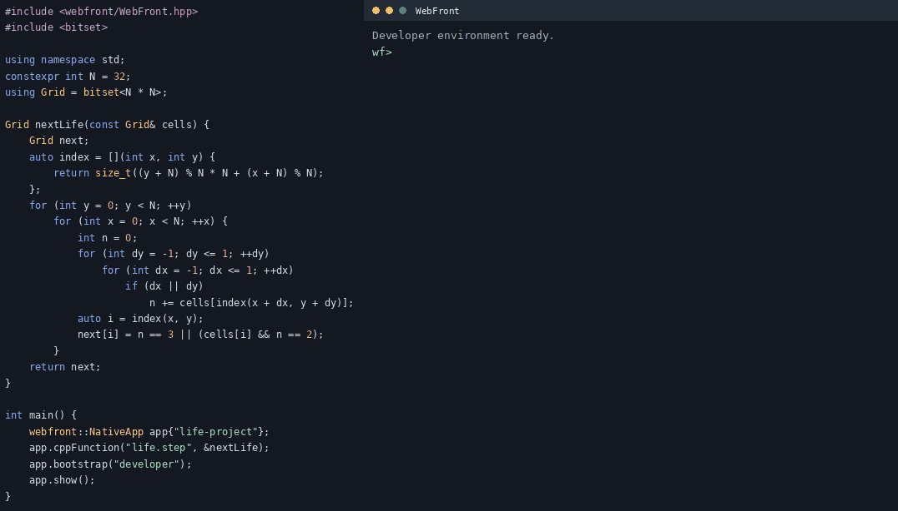
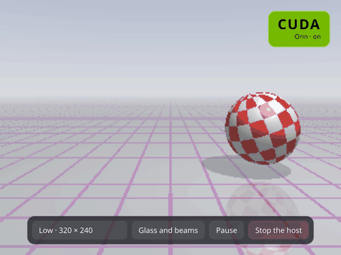
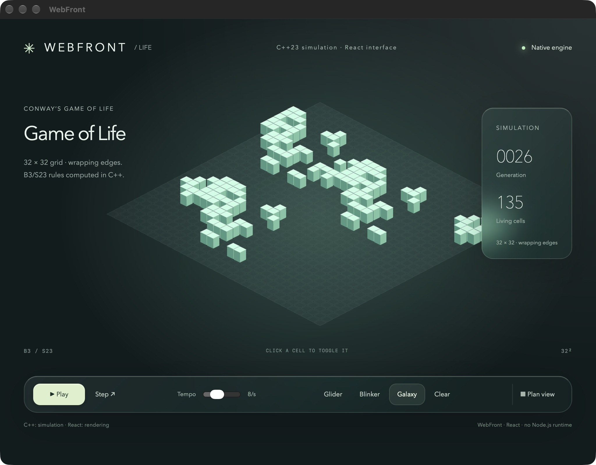

#  WebFront


[](https://github.com/ambroise-leclerc/WebFront/actions/workflows/BuildAndTest.yml)
[](https://github.com/ambroise-leclerc/WebFront/actions/workflows/BuildAndTest.yml)
[](https://github.com/ambroise-leclerc/WebFront/actions/workflows/BuildAndTest.yml)
[](https://github.com/ambroise-leclerc/WebFront/actions/workflows/BuildAndTest.yml)
[](https://github.com/ambroise-leclerc/WebFront/actions/workflows/BuildAndTest.yml)
[](docs/JETSON.md)
[](CMakeLists.txt)
[](include/)

[English](README.md) · [Français](README.fr.md)

WebFront est une bibliothèque d’interface C++ **conçue pour le développement agentique.** Elle est C++23 header-only : votre logique reste en C++ et l’interface s’écrit en TypeScript, React et avec l’écosystème de paquets du navigateur. Un seul appel, `app.bootstrap("developer")`, fait héberger à votre application, dans sa propre fenêtre, un environnement complet de développement et de test : compilateur TypeScript/TSX, vérification des types, exécution des tests Jasmine, dépendances verrouillées et embarquement, tous pilotés par les mêmes commandes `wf`. Une personne les saisit dans le terminal ; **tout agent de programmation qui parle MCP les exécute lui-même**, puis regarde le résultat, clique dessus et appelle les fonctions C++ que vous autorisez. Aucun Node.js, npm ou outil séparé n’est à installer, et l’application finale tient en un exécutable qui fonctionne hors ligne.

WebFront n’a aucune dépendance et peut être déployé sur tout appareil disposant d’une bibliothèque standard C++ récente.

<a href="#jeu-de-la-vie--du-calcul-c-à-lapplication-native"></a>

L'animation présente le programme C++ et l'interface ; les temps d'attente sont condensés et l'aperçu agrandi pour la lisibilité. Le [parcours ci-dessous](#jeu-de-la-vie--du-calcul-c-à-lapplication-native) utilise les sources compilées du dépôt.

- **Laissez un agent faire le travail.** Il crée l’interface, installe les paquets, vérifie les types, teste, prévisualise et embarque par MCP, puis inspecte et clique la fenêtre en cours d’exécution et appelle les fonctions C++ que vous avez listées. L’application est le serveur MCP : aucun autre programme, rien d’actif par défaut, et chaque autorisation reste la vôtre, fixée dans le code natif. [Développer avec un agent →](#développer-avec-un-agent) · [Automatisation →](#laisser-un-agent-piloter-votre-application)
- **Obtenez un environnement complet sans installation.** `wf` compile, vérifie les types, teste et embarque l’interface depuis un environnement épinglé, vérifié par SHA-512 et mis en cache au premier usage. Le manifeste et le verrou font reproduire à chaque machine, et à chaque agent, la même construction. [Environnement de développement →](docs/DEVELOPER_ENVIRONMENT.md)
- **Intégrez WebFront à une application existante.** Conservez votre simulation, le contrôle de vos appareils, vos calculs SIMD, vos noyaux CUDA… et vos threads de travail en C++. Utilisez une fenêtre native ou même un navigateur web tout en gardant la maîtrise de votre boucle d’événements, et lancez plusieurs applications ou fenêtres côte à côte. [Intégration à l’application hôte →](docs/HOST_INTEGRATION.md)
- **Transférez directement les données numériques.** Les tableaux typés et les ensembles de bits compactés transitent par une passerelle WebSocket binaire, sans conversion en JSON ou en base64. Coroutines, futures et senders relient les appels asynchrones de l’interface aux traitements natifs. [Modèle d’exécution →](docs/ASYNC_EXECUTION.md)
- **Préparez votre application pour la distribution.** Embarquez les ressources, verrouillez les versions des paquets et vérifiez les téléchargements ; l’application obtenue fonctionne hors ligne. Les cibles CMake pour les projets utilisateurs, les tests dans le navigateur et le framework public `webfront::bdd` facilitent les compilations reproductibles et l’intégration continue. [Intégration →](#intégrer-webfront-dans-votre-projet) · [Tests →](#tester-votre-application)
- **Choisissez vos technologies d’interface.** Utilisez TypeScript, React et des paquets compatibles avec les navigateurs, ou créez des îlots DOM directement en C++. Des composants optionnels permettent de générer des formulaires et des inspecteurs à partir de descripteurs de types C++. [DOM →](docs/DOM.md) · [React →](docs/REACT.md) · [Formulaires →](docs/FORMS.md)

**Site et livre : [webfront.fr](https://webfront.fr/fr/)** · [Le livre WebFront](https://webfront.fr/fr/book/) · [Documentation](docs/) · [Historique des versions](docs/CHANGELOG.md)

## Plateformes et déploiement

| Cible | Interfaces possibles | Périmètre de validation |
| --- | --- | --- |
| Windows | Navigateur système, WebView2 natif, CEF optionnel | CI desktop avec MSVC ; WebView2 nécessite le runtime Evergreen |
| macOS 13.3+ pour la fenêtre native | Navigateur système, WKWebView système, CEF optionnel | CI desktop avec AppleClang |
| Linux | Navigateur système, WebKitGTK 6.0 natif, CEF optionnel | CI desktop avec GCC ; couverture Clang étendue |
| Linux ARM64 / NVIDIA Jetson | Navigateur système, WebKitGTK ou CEF selon disponibilité | CI ARM64 avec GCC 13 et validation sur **Orin Nano Super 8 Go** ; voir le [guide Jetson](docs/JETSON.md) |

Conçu pour suivre le C++ standard sur les différentes plateformes, le cœur utilise ses mécanismes et un fournisseur réseau remplaçable. Le chemin navigateur système évite de lier un toolkit graphique ou un moteur de fenêtre web natif. La cible doit fournir un **compilateur et une bibliothèque standard C++23 adaptés, le réseau et les threads du système, ainsi qu'un navigateur**. GCC 13 est le minimum avec support au mieux ; la [politique de support](docs/adr/ADR-022-profils-et-niveaux-de-support.md) précise les chaînes testées et leurs engagements.

**Sans dépendance. Aucun runtime WebFront séparé.** Le cœur suit le modèle du réseau et de l'exécution du C++ standard. En attendant la standardisation et la disponibilité de ces mécanismes dans les bibliothèques standard, CMake fournit des implémentations externes épinglées : la couche réseau `stdnet` maintenue pour cette transition et, si nécessaire, `stdexec` pour les senders. Elles assurent l'intérim à la compilation ; aucun binaire de bibliothèque WebFront n'est à installer. Les fenêtres natives conservent les prérequis de leur plateforme ; CEF est optionnel. L'environnement de développement met ses outils et paquets vérifiés en cache au premier usage ; la version de production embarquée n'a besoin ni de ce cache ni des sources de l'interface.

### CUDA et applications embarquées

**Gardez CUDA dans votre application C++, y compris sur NVIDIA Jetson Orin Nano.** WebFront n'impose pas le moteur de calcul : votre boucle hôte ou vos workers exécutent le code CPU ou CUDA, tandis que l'interface modifie les paramètres et affiche les résultats par tableaux typés. Isolez les unités `.cu` des en-têtes C++23 de WebFront lorsque le compilateur CUDA l'exige. Aucun toolkit CUDA n'est nécessaire aux applications qui ne l'utilisent pas.

**L'[exemple Boing Ball fourni](docs/HOST_LOOP_EXAMPLE.md) fonctionne sur CPU ou CUDA.** Une balle à damier rebondit au-dessus d'un sol réfléchissant ; passez au verre teinté pour découvrir réflexion, réfraction et faisceaux de lumière colorée. Chaque pixel est calculé par l'hôte C++, tandis que la page affiche le tableau typé sur un canvas. La même boucle hôte fonctionne avec une fenêtre native ou le navigateur système.



```bash
cmake --build build --target WebFrontHostLoop --parallel 2
build/examples/WebFrontHostLoop --quality 0
# Avec un moteur CUDA compilé et un GPU disponible :
build/examples/WebFrontHostLoop --engine cuda --glass --stats
```

Avec un générateur multi-configuration comme Visual Studio, remplacez `build/examples/` dans les commandes ci-dessus par `build/examples/Debug/`, ou `build/examples/Release/` après une construction avec `--config Release`. L’exécutable se nomme `WebFrontHostLoop.exe`.

Ces commandes partent de la racine du dépôt, après configuration. CUDA est détecté automatiquement ; `-DWEBFRONT_HOST_LOOP_CUDA=OFF` construit l'exemple CPU complet sans toolkit. Ajoutez `--browser` pour choisir le navigateur système. Le [guide de l'exemple](docs/HOST_LOOP_EXAMPLE.md) décrit qualité, benchmark et configuration du compilateur CUDA séparé.

**Qualifié sur Jetson Orin Nano Super 8 Go :** constructions sur carte réelle, rendu CPU/CUDA, tests de fenêtre native et du pont, vérifications d'une distribution avec sandbox. Un [workflow de validation matérielle](docs/JETSON_RUNNER.md) de confiance complète la CI ARM64 hébergée. La [qualification de la carte](docs/JETSON.md) et les [mesures de rendu](docs/HOST_LOOP_EXAMPLE.md) précisent la pile testée et le périmètre. NX/AGX et les autres versions JetPack demandent leur propre qualification ; ces résultats n'établissent pas l'accélération du rendu à l'intérieur du sandbox WebKit.

Sous Linux, WebKitGTK utilise par défaut le mode développement, avec son sandbox désactivé. Pour distribuer, sélectionnez `-DWEBFRONT_DISTRIBUTION=ON` et incluez le profil de sandbox de l'application lorsque nécessaire. [Développement et distribution →](docs/WEBKITGTK.md#development-and-distribution)

## Des mécanismes conçus pour les performances

Conservez les calculs lourds dans le code natif et transmettez les données utiles à l'interface : les buffers numériques restent typés, les bitsets empaquetés et les appels asynchrones. Le serveur possède son thread ; votre boucle de calcul et vos workers restent indépendants. L'adaptateur React optionnel regroupe les mises à jour des instantanés C++ par navigateur, et l'API DOM regroupe les écritures.

Ces mécanismes permettent de maîtriser sérialisation, fréquence des mises à jour et coût de l'interface. Les performances complètes dépendent aussi de la taille des messages, du rendu et du matériel. Mesurez séparément calcul, transport et affichage ; le [guide d'exécution](docs/ASYNC_EXECUTION.md) précise où tourne le travail et comment garder les callbacks réactifs.

Exemple mesuré sur **Orin Nano Super 8 Go à 25 W**, dans une fenêtre WebKitGTK 2.52.6 avec sandbox :

| Scène | CPU (6 threads) | CUDA |
| --- | ---: | ---: |
| Balle opaque | 12 images/s | 21 images/s |
| Verre et faisceaux lumineux | Environ 0,6 image/s | 12 images/s |

Scène de 960 × 720, quatre rayons par pixel ; fenêtre de 800 × 600 pixels CSS. Construction Release, GCC 13.3, CUDA 13.2.86, L4T R39.2.1. Ces observations sont propres à cette carte, sans garantie universelle de débit. Le [rapport de mesure](docs/HOST_LOOP_EXAMPLE.md#system-browser-and-distribution-follow-up) distingue calcul, copie, transport et affichage, et compare navigateur système et fenêtre native.

## Par où commencer ?

- **Travailler avec un agent :** [parcours de développement](#développer-avec-un-agent) et [automation de l'application](#laisser-un-agent-piloter-votre-application).
- **Évaluer la bibliothèque :** [Hello World](#hello-world), puis le [parcours du jeu de la vie](#jeu-de-la-vie--du-calcul-c-à-lapplication-native).
- **Ajouter une interface à un logiciel existant :** [intégration CMake](#intégrer-webfront-dans-votre-projet) et [exemple de boucle hôte](examples/host-loop/HostLoop.cpp).
- **Préparer la production :** [tests](#tester-votre-application), [contrats et limites](#contrats-et-limites) et [état du support](docs/PROJECT_STATUS.md).

## Développer avec un agent

Une application WebFront est un programme C++ dont l'interface TypeScript/TSX se trouve dans **`ui/`** (`ui/main.ts` ou `ui/main.tsx`). Elle se développe avec **`wf dev`**, dans le terminal ouvert par `app.bootstrap("developer")`. Des pages HTML et JavaScript servies par `documentRoot` restent possibles, mais ne constituent pas ce parcours outillé.

Avec l'environnement épinglé, l'ordre est : `wf create app` (nom du starter, pas du projet), `wf init`, `wf install <paquet>` pour les dépendances navigateur, puis `wf dev ui/main.ts`. Terminez par `wf check`, `wf test` et `wf embed` selon la configuration du projet. `wf create life` fournit le starter React du parcours ci-dessous ; `wf help agents` décrit la marche à suivre.

**L'agent exécute les commandes lui-même**, par MCP, sans demander à l'utilisateur de les saisir. Dans une build de développement, l'application active l'automatisation avec `webfront::automation::enableAutomation(app, {.grants = {...}})` ; les autorisations restent choisies par son propriétaire. L'application devient alors le serveur MCP : aucun autre programme n'est construit ni lancé. Elle affiche son URL et le chemin d'une configuration cliente privée (`mcp.json`, avec l'URL et un jeton Bearer, hors du projet) :

```text
WebFront MCP (grants: check, build, preview): http://127.0.0.1:PORT/mcp - client configuration: .../sessions/SESSION/mcp.json
```

```json
{"mcpServers": {"webfront": {"type": "http", "url": "http://127.0.0.1:PORT/mcp", "headers": {"Authorization": "Bearer TOKEN"}}}}
```

Donnez ce fichier au client MCP (`claude --mcp-config PATH/mcp.json`) et ne copiez jamais le jeton dans le projet. L'agent appelle ensuite `webfront.start` avec `create`, `preview` (après chaque modification, à la place de `wf dev`), `check`, `test` ou `embed`, et suit chaque exécution avec `webfront.result`.

Dans un projet consommateur, `webfront_write_agent_guide()` écrit un `AGENTS.md` à la racine ; `wf create` le place à côté des sources du starter. Le [guide des agents](docs/DEVELOPING_WITH_AGENTS.md) détaille ce contrat.

## Du C++ à une interface réactive

Enregistrez votre calcul, ouvrez les outils, puis construisez l'interface dans le terminal de l'application. `life-project` désigne le répertoire de travail de l'interface.

## Hello World

Le programme minimal [HelloWorld.cpp](examples/hello-world/HelloWorld.cpp) sert la page embarquée et l'ouvre dans le navigateur système. `webfront::WebFront` sélectionne toujours ce navigateur.

```cpp
#include <webfront/WebFront.hpp>

int main() {
    webfront::WebFront app;
    app.show();
}
```

```bash
mkdir build
cd build
cmake ..
cmake --build .
examples/HelloWorld
```

Avec Visual Studio, lancez `examples\Debug\HelloWorld.exe` ; `--config Release` sélectionne `examples\Release\`. Appuyez sur Entrée dans le terminal pour arrêter le serveur.

L'[API DOM](docs/DOM.md) permet aussi de construire la page en C++, sans fichiers d'interface :

```cpp
#include <webfront/WebFront.hpp>

int main() {
    webfront::WebFront app;
    app.onUIStarted([](auto ui) {
        auto doc = ui.document();
        auto root = doc.island();
        auto button = doc.element("button");
        auto label = doc.text("Cliquez ici");
        button.append(label);
        button.listen("click", [label](std::string) { label.setText("Cliqué"); });
        root.append(button);
    });
    app.show();
}
```

## Jeu de la vie : du calcul C++ à l'application native

L'exemple part d'une simulation C++, ajoute une interface React puis l'embarque dans l'exécutable. Prérequis : Git, CMake **3.31+** et un compilateur C++23 (GCC **13+**, avec support S2 au mieux pour GCC 13). Voir les [outils des distributions LTS](#outils-de-construction-sur-les-distributions-lts) et la [politique compilateur](docs/adr/ADR-022-profils-et-niveaux-de-support.md).

La première configuration CMake, le premier bootstrap et les premières installations de paquets nécessitent Internet. Les ressources téléchargées sont ensuite mises en cache et vérifiables hors ligne.

```bash
git clone https://github.com/ambroise-leclerc/WebFront.git
cd WebFront
mkdir build
cd build
cmake ..
cmake --build .
```

Aucune option n'est nécessaire. Les commandes suivantes partent de ce répertoire `build`. Avec Visual Studio, les exécutables sont dans `examples\Debug\`, ou `examples\Release\` avec `--config Release`.

### 1. Partir du calcul C++

[Life.hpp](examples/life/Life.hpp) applique les règles B3/S23 de Conway sur une grille torique de 32 × 32 cellules. Chaque génération produit un `std::bitset<1024>`. [LifeConsole.cpp](examples/life/LifeConsole.cpp) l'exécute sans interface :

```bash
examples/WebFrontLifeConsole
```

Avec Visual Studio, lancez `examples\Debug\WebFrontLifeConsole.exe`, ou `examples\Release\WebFrontLifeConsole.exe` après une construction avec `--config Release`.

### 2. Ajouter la fenêtre et les outils

L'ajout essentiel de [LifeDeveloper.cpp](examples/life/LifeDeveloper.cpp) est :

```cpp
#include "LifeFrontend.hpp"

webfront::demo::LifeApp app{"life-project"};
app.cppFunction("life.step", &webfront::demo::nextLife);
app.bootstrap("developer");
app.show();
```

Lancez l'application :

```bash
examples/WebFrontLifeDeveloper
```

Avec Visual Studio, lancez `examples\Debug\WebFrontLifeDeveloper.exe`, ou `examples\Release\WebFrontLifeDeveloper.exe` après une construction avec `--config Release`.

L'exemple crée `life-project` dans le répertoire courant s'il manque et réutilise un projet existant sans écraser ses fichiers. `bootstrap("developer")` charge la version épinglée de l'environnement, vérifie son SHA-512 et la met en cache. Le terminal fournit les commandes `wf`, ainsi que `ls`, `cat`, `tree` et `mounts`, sans exposer de shell système.

**Fenêtre native détectée automatiquement :**

| Plateforme | Moteur | Condition |
| --- | --- | --- |
| Windows | WebView2 Evergreen | Compilateur compatible MSVC ; SDK téléchargé et runtime Evergreen vérifié au démarrage |
| macOS 13.3+ | Cocoa / WebKit système | Clang et cible de déploiement d'au moins 13.3 |
| Linux | WebKitGTK 6.0 | Détection par `pkg-config webkitgtk-6.0` ; [installation](docs/WEBKITGTK.md) |

Si le moteur manque, CMake indique quoi installer et l'exemple ouvre le navigateur système. Installez le prérequis et relancez `cmake ..` pour obtenir la fenêtre native. CEF (`-DWEBFRONT_EMBED_CEF=ON`) rend son frontend disponible, mais les exemples ne le sélectionnent pas.

La fenêtre native est construite et affichée sur le thread principal ; le serveur possède son thread. Fermer la fenêtre arrête le serveur. Un échec au démarrage renvoie un statut non nul.

**Options avancées :** `-DWEBFRONT_EMBED_WEBVIEW2=ON|OFF`, `-DWEBFRONT_EMBED_WKWEBVIEW=ON|OFF` et `-DWEBFRONT_EMBED_WEBKITGTK=ON|OFF` imposent le choix ; `-DWEBFRONT_AUTODETECT_NATIVE=OFF` désactive la détection. Une valeur explicite est conservée. `cmake .. -UWEBFRONT_EMBED_WKWEBVIEW` rétablit la détection macOS ; adaptez le nom pour les autres moteurs. Les constructions de tests conservent une sélection explicite.

Un autre projet et une autre archive vérifiée peuvent être fournis : `examples/WebFrontLifeDeveloper <project> [<environment-url> <sha512-integrity>]`. Voir la [référence de l'environnement](docs/DEVELOPER_ENVIRONMENT.md).

### 3. Créer l'interface React

Dans le terminal de l'application :

```text
wf create life
wf init
wf install react@19.3.1 react-dom@19.3.1
wf dev ui/main.tsx
```

`wf create life` écrit le [starter TSX et CSS](examples/life/ui) dans `ui/` sans écraser un répertoire existant. `wf init` crée le manifeste `webfront.project.json`. `wf install` résout et vérifie les paquets, puis verrouille leurs versions dans `webfront-packages.lock.json`, sans lancer de scripts d'installation. `wf restore` reconstruit le cache depuis ce verrou ; `wf restore --offline` le vérifie sans réseau.

`wf dev` compile le TSX avec esbuild-wasm, ouvre l'interface et la reconstruit à chaque sauvegarde. Les erreurs apparaissent dans le terminal et l'aperçu, qui conserve sa dernière version valide. Ctrl+C l'arrête ; `wf build` compile une fois.

Éditez `life-project/ui/main.tsx` et `style.css` avec votre éditeur habituel. React dessine la grille ; chaque génération attend C++ :

```js
await webFront.ready;
const step = webFront.cppFunction('life.step');
const next = await step(cells);
```

`cells` et `next` sont des `Uint8Array` de 128 octets correspondant à `std::bitset<1024>`, bit de poids faible en premier dans chaque octet. Tout appel JavaScript vers C++ renvoie une Promise : attendez-la ou traitez son rejet. Les règles du jeu restent en C++.

### 4. Tester et vérifier les types

Installez Jasmine et créez `life-project/tests/life.spec.js` :

```text
wf install jasmine-core@7.0.2
```

```js
describe('la grille Life', () => {
    it('encode 32 fois 32 cellules dans 128 octets', () => {
        const cells = new Uint8Array(32 * 32 / 8);
        for (const i of [330, 331, 332]) cells[i >> 3] |= 1 << (i & 7);
        expect(cells.length).toBe(128);
        expect(cells[41]).toBe(0b00011100);
    });
});
```

Ajoutez ce champ au manifeste (`wf init` ne copie pas cette recette) :

```json
"test": {"specs": ["tests/life.spec.js"]}
```

Puis lancez :

```text
wf test
```

Les specs tournent dans la fenêtre avec la version verrouillée de Jasmine. Un échec renvoie un code non nul.

La compilation TSX retire les types sans les vérifier ; `wf check` utilise le compilateur TypeScript verrouillé par le projet. Créez `life-project/tsconfig.json` :

```json
{
  "compilerOptions": {
    "strict": true,
    "target": "ES2022",
    "module": "ESNext",
    "moduleResolution": "Bundler",
    "jsx": "react-jsx",
    "lib": ["ES2022", "DOM", "DOM.Iterable"],
    "noEmit": true
  },
  "include": ["ui"]
}
```

```text
wf install typescript@5.9.3 @types/react@19.3.0 @types/react-dom@19.3.0
wf check
```

### 5. Essayer le résultat



Lancez ou suspendez la simulation, avancez d'une génération, dessinez des cellules, changez de motif, de vitesse ou de vue. Les compteurs reflètent le calcul C++. Une seule demande de génération est en cours à la fois ; un échec arrête la lecture et s'affiche dans l'interface.

### 6. Embarquer pour distribuer

Déclarez l'entrée et le provider dans le manifeste (`"entries": {"main": "ui/main.tsx"}` et `"providers": {"LifeUI": {"entry": "main", "output": "generated/LifeUI.hpp"}}`), ou passez-les explicitement :

```text
wf embed ui/main.tsx --output generated/LifeUI.hpp
```

La commande compile et rassemble ressources et notices des dépendances dans un en-tête C++ compressé. Fermez la fenêtre de développement, puis reconfigurez le même répertoire `build` :

```bash
cmake .. -DWEBFRONT_LIFE_ASSETS="$PWD/life-project/generated/LifeUI.hpp"
cmake --build . --target WebFrontLifeEmbedded
examples/WebFrontLifeEmbedded
```

Avec Visual Studio, lancez `examples\Debug\WebFrontLifeEmbedded.exe`, ou `examples\Release\WebFrontLifeEmbedded.exe` après une construction avec `--config Release`.

[LifeEmbedded.cpp](examples/life/LifeEmbedded.cpp) remplace le projet de développement par le provider généré :

```cpp
#include "LifeFrontend.hpp"

webfront::demo::LifeAppWithAssets<webfront::fs::LifeUI> app;
app.cppFunction("life.step", &webfront::demo::nextLife);
app.show();
```

La recompilation est explicite. L'application fonctionne ensuite hors ligne, sans répertoire projet, callbacks de développement ni cache d'outils. Les prérequis de déploiement du moteur natif restent applicables : ceci ne fabrique pas un installateur.

[LifeFrontend.hpp](examples/life/LifeFrontend.hpp) sélectionne `NativeOrBrowserFrontend` : fenêtre native disponible, sinon navigateur. Votre application peut choisir `NativeApp` ou `NativeAppWithAssets` lorsqu'une fenêtre native est obligatoire.

## Laisser un agent piloter votre application

Un agent peut vérifier les types, construire, prévisualiser, inspecter et cliquer l'interface de **votre application**, dans sa fenêtre et avec ses callbacks C++. Rien n'est activé par défaut.



*Transcription abrégée du test de régression `AutomationConsumerWindow`, exécuté sur une application réelle.*

Les autorisations sont fixées dans le code natif :

```cpp
#include <webfront/automation/Enable.hpp>

webfront::NativeApp app{project};
app.bootstrap("developer");
app.cppFunction("bf.render", render);
auto automation = webfront::automation::enableAutomation(
    app, {.grants    = {"check", "build", "preview", "inspect", "interact", "call"},
          .callbacks = {"bf.render"}});
app.show(automation->launchPage());
automation->close();
app.shutdown();
```

- **Visible.** L'application affiche son URL MCP, et le terminal annonce les autorisations.
- **Découvrable.** Chaque instance en cours publie son URL et le chemin de son `mcp.json` privé dans un enregistrement par utilisateur, jamais le jeton ; `claude --mcp-config PATH/mcp.json` ou tout client MCP s'y connecte.
- **Borné.** Chaque opération demande son autorisation ; seuls les callbacks nommément déclarés sont appelables. Des délais natifs arrêtent un renderer bloqué. Le code du projet conserve les droits de l'utilisateur : ce n'est pas un sandbox.
- **Optionnel.** Sans `enableAutomation`, rien n'est enregistré et aucun port n'est ouvert ; une build de distribution (`WEBFRONT_DISTRIBUTION`) refuse de le compiler.

Le [guide d'automation](docs/AUTOMATION.md#automating-your-own-application) décrit permissions, découverte, délais et profil MCP.

## Intégrer WebFront dans votre projet

L'implémentation réside dans `include/`. CMake apporte les implémentations C++ de transition et les réglages de plateforme :

```cmake
add_subdirectory(path/to/WebFront)
add_executable(MyApp main.cpp)
target_link_libraries(MyApp PRIVATE WebFront::WebFront)
```

En sous-projet, exemples et tests sont désactivés par défaut et les réglages de compilation internes ne se propagent pas à vos cibles. `WEBFRONT_BUILD_EXAMPLES=OFF` désactive aussi les exemples en construction autonome.

Avec GCC 16, l'analyse des modules C++ de CMake peut faire planter le compilateur dans stdexec. Pour une cible sans modules, ajoutez `webfront_disable_module_scan(MyApp)` après sa création. Si aucun de vos projets n'utilise les modules, `set(CMAKE_CXX_SCAN_FOR_MODULES OFF)` avant de créer les cibles est une autre possibilité. Voir les [détails en anglais](README.md#use-webfront-in-your-project).

Pour activer la fenêtre native détectée :

```cmake
webfront_use_native_window(MyApp)
```

Puis sélectionnez le type d'application :

```cpp
#include <webfront/WebFront.hpp>

#if defined(WEBFRONT_NATIVE_WINDOW)
using App = webfront::WebFrontWithFrontend<webfront::frontend::NativeWebViewFrontend>;
#else
using App = webfront::WebFront;
#endif

int main() {
    App app;
    app.show();
}
```

Pour revenir au navigateur lorsqu'aucune session native ne peut s'ouvrir (SSH, conteneur ou CI, par exemple), choisissez `WebFrontWithFrontend<webfront::frontend::NativeOrBrowserFrontend>` sans `#if`. La raison du repli est annoncée. Les helpers fonctionnent aussi après CPM ; la [référence des frontends](docs/FRONTENDS.md) décrit les sélections explicites.

Une application qui possède sa boucle utilise `app.start()` avec le navigateur système. Les fenêtres natives imposent leurs règles de thread : `show()` sur le thread principal pour WKWebView, WebKitGTK et CEF ; `UIThread` possible avec WebView2. Voir [l'intégration hôte](docs/HOST_INTEGRATION.md) et [HostLoop.cpp](examples/host-loop/HostLoop.cpp).

## Tester votre application

L'intégration optionnelle [Jasmine et CTest](docs/CONSUMER_TESTING.md) exécute des specs sur la page réelle de l'application. Elle permet captures PNG, séquences d'images et lancement de programmes natifs explicitement autorisés par le propriétaire des tests, dans des espaces temporaires privés. Le parcours navigateur avec programmes natifs est validé sur Linux avec CEF ; le guide précise les autres limites. Ces programmes conservent les droits de l'utilisateur.

`webfront::embeddedFrontendAvailable` indique si un moteur embarqué est compilé ; `webfront::EmbeddedWebFront` le sélectionne.

## Construire et tester la bibliothèque

```bash
cmake -S . -B build -DCMAKE_BUILD_TYPE=Release \
  -DWEBFRONT_EMBED_CEF=OFF -DWEBFRONT_ENABLE_TESTING=ON
cmake --build build --parallel 2
ctest --test-dir build --output-on-failure --parallel 4
```

La configuration des tests télécharge et vérifie par SHA-512 l'environnement épinglé et les paquets du registre de test. Les ressources du cœur sont générées et vérifiées par CMake seul ; les constructions normales utilisent les en-têtes versionnés. Les tests navigateur demandent un moteur activé ; sous Linux, ils nécessitent Xvfb. Désactivez explicitement WebKitGTK avec `-DWEBFRONT_EMBED_WEBKITGTK=OFF` pour un parcours uniquement C++ si nécessaire.

`ctest -L fast` sélectionne les tests rapides. Les [tiers de tests](docs/TEST_TIERS.md) précisent la matrice desktop par PR, les validations étendues et la CI ARM64. Le [guide contributeur](AGENTS.md) contient les commandes, et les [mesures de tests](docs/TEST_PERFORMANCE.md) expliquent le parallélisme et les verrous de ressources.

## Outils de construction sur les distributions LTS

CMake **3.31+** est requis, y compris en sous-projet sans tests. Ubuntu 22.04 fournit CMake 3.22.1 et Ubuntu 24.04 CMake 3.28.3 : installez une version plus récente. Git 2.34.1 convient aux contrôles du dépôt.

Une installation Python isolée évite de remplacer l'outil système. Installez `python3-venv` si nécessaire, puis :

```bash
python3 -m venv "$HOME/.local/share/webfront-tools"
"$HOME/.local/share/webfront-tools/bin/python" -m pip install 'cmake>=3.31,<4'
export PATH="$HOME/.local/share/webfront-tools/bin:$PATH"
cmake --version
ctest --version
```

L'installation de CMake elle-même ne demande pas de droits root. Répétez l'export de `PATH` dans chaque shell de construction, ou placez-le dans votre profil. Le [dépôt APT Kitware](https://apt.kitware.com/) est une alternative. Mettre CMake à jour ne met pas le compilateur à jour : GCC 11 fourni par défaut sous Ubuntu 22.04 reste insuffisant. Voir la [décision sur les outils](docs/adr/ADR-022-profils-et-niveaux-de-support.md).

## Contrats et limites

- Le serveur HTTP/WebSocket appartient à WebFront et tourne en arrière-plan. Les callbacks s'exécutent séquentiellement sur son thread : évitez de le bloquer. Les appels navigateur peuvent partir des threads hôtes pendant la vie de l'application. Les coroutines applicatives appartiennent à `app.spawn` ou `ui.spawn` ; voir [exécution et annulation](docs/ASYNC_EXECUTION.md).
- Les appels JavaScript vers C++ renvoient toujours des Promises. En C++, `ui.jsFunction(name)(...)` est sans retour ; `ui.jsFunction<R>(name)(...)` renvoie un `std::future<R>`. Fonction absente, exception, réponse mal formée et déconnexion font échouer l'appel typé. Les futures et Promises n'exposent pas d'annulation ; les senders typés proposent une annulation locale.
- Le pont transporte scalaires, chaînes, tuples, tableaux numériques typés, bitsets et listes homogènes de valeurs composées prises en charge. Il ne transporte pas d'objets arbitraires. Chaînes et messages sont bornés par la politique de taille (64 Mio par défaut) ; à partir de 65 536 octets, les chaînes utilisent l'encodage long.
- L'environnement de développement et l'accès aux fichiers du projet sont destinés au code local de confiance, sans sandbox. Seuls les paquets compatibles navigateur sont pris en charge ; ni scripts d'installation ni extensions natives ne sont exécutés. `wf check` vérifie les types séparément de la compilation.
- Le [pseudo-terminal natif](docs/PTY.md) relie un programme choisi par l’application à xterm.js sous Linux, macOS et Windows, après activation explicite.
- L'adaptateur optionnel [`@webfront/react`](docs/REACT.md) apporte stores C++ avec regroupement des mises à jour et îlots React. `WebFrontLifeReact` montre un panneau C++ dans React ; son archive est préparée localement pour publication au registre.
- Linux embarqué dispose d'une CI ARM64 et de preuves sur Orin Nano. Les autres cartes, cibles sans OS et microcontrôleurs ne sont pas qualifiés globalement. Le transport local ne fournit ni TLS ni authentification client ; un accès distant demande une conception de sécurité propre à l'application.
- Packaging, accessibilité et déploiement des moteurs natifs restent propres au produit. L'[état du projet](docs/PROJECT_STATUS.md) fait référence pour les validations et limites ; l'[historique](docs/CHANGELOG.md) décrit les migrations et ruptures de compatibilité.

## Licence

WebFront est proposé sous double licence **Apache-2.0 OU CECILL-B**, au choix. Vous pouvez l'utiliser, le modifier et le redistribuer sous l'une de ces licences sans devoir respecter les deux simultanément. [LICENSE](LICENSE) contient les textes complets, dont les versions française et anglaise de CeCILL-B.

Les composants tiers conservent leurs licences et notices ; le choix de licence WebFront ne les remplace pas.

[Site](https://webfront.fr/fr/) · [Livre](https://webfront.fr/fr/book/) · [Environnement de développement](docs/DEVELOPER_ENVIRONMENT.md) · [Décisions d'architecture](docs/adr/README.md) · [Contribuer](.github/CONTRIBUTING.md)
