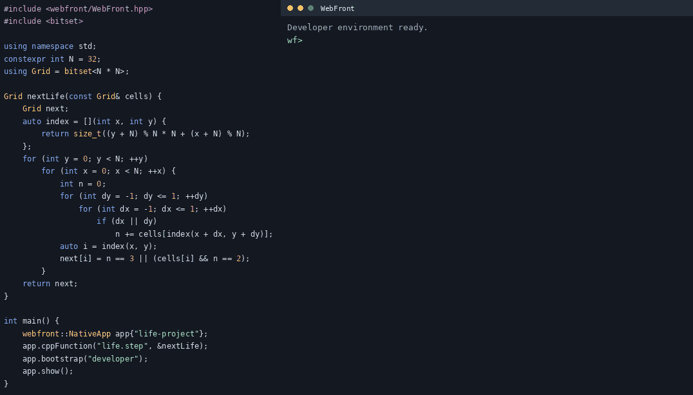
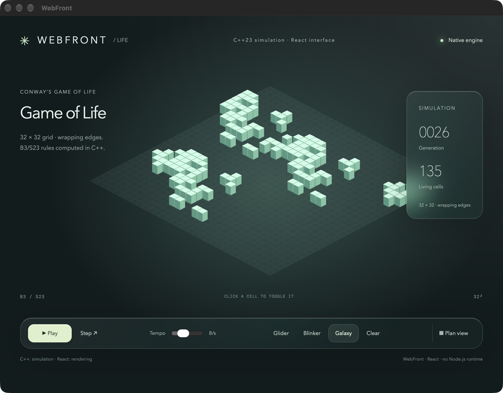

#  WebFront

[](https://github.com/ambroise-leclerc/WebFront/actions/workflows/BuildAndTest.yml)
[](https://github.com/ambroise-leclerc/WebFront/actions/workflows/BuildAndTest.yml)
[](https://github.com/ambroise-leclerc/WebFront/actions/workflows/BuildAndTest.yml)
[](https://github.com/ambroise-leclerc/WebFront/actions/workflows/BuildAndTest.yml)
[](CMakeLists.txt)
[](include/)

**WebFront is a header-only C++23 library for building rich, modern user interfaces.**
Keep application logic in C++ and create reactive interfaces with TypeScript, React and the existing JavaScript package ecosystem. WebFront brings the UI tools into your application: there is no separate JavaScript development environment to install.

**Website and book: [webfront.fr](https://webfront.fr/en/)** ([en français](https://webfront.fr/fr/)) · [The WebFront Book](https://webfront.fr/en/book/) · [Documentation](docs/) · [Changelog](docs/CHANGELOG.md)

- **C++ in front, web technologies for the screen.** Functions registered with `cppFunction` are called from TypeScript over an asynchronous binary bridge; C++ calls browser functions with `ui.jsFunction`.
- **Native window or browser, same sources.** WebView2 (Windows), WKWebView (macOS), WebKitGTK (Linux), optional CEF, or the system browser as fallback.
- **A development environment inside your application.** `wf` installs dependencies, compiles TS/TSX, type-checks, runs Jasmine specs and previews on save, with no Node.js or package manager on the machine.
- **One executable to ship.** `wf embed` packages the interface into a C++ header; the distributed build runs offline without the development tools.
- **Ready for AI harnesses.** An optional local launcher (MCP or JSON CLI) lets an agent create, check, build and test a screen under explicit grants.

Desktop Windows, macOS and Linux are the qualified platforms; embedded targets and microcontrollers are not. WebFront already drives a real application: [SiliconForge](https://github.com/ambroise-leclerc/SiliconForge), a microcontroller simulator.

## Developing with an agent

If you are a coding agent, or work with one, read this before anything else. The [agent guide](docs/DEVELOPING_WITH_AGENTS.md) has the details.

- **The model.** A WebFront application is a C++ program whose interface is TypeScript/TSX. The interface lives in **`ui/`** of the project directory (`ui/main.ts` or `ui/main.tsx`) and is developed with **`wf dev`**, in the terminal that `app.bootstrap("developer")` opens in the application's window. Pages of hand-written HTML and classic JavaScript served through `documentRoot` are not the development path: none of the tools apply to them.
- **The sequence.** `wf create app` (a starter, not your project's name; needs environment 0.9.2 or later, otherwise write `ui/main.ts` yourself, run `wf init` and then `wf install` without argument (the lock that `wf preview` needs before 0.9.2); `life` is the React example), `wf init`, `wf install <package>` if the interface imports npm packages, `wf dev ui/main.ts`, then `wf check`, `wf test` and `wf embed`. `wf help agents` prints it in the terminal.
- **An agent runs `wf` itself, in JSON or MCP.** Do not ask a person to type the commands. Configure with `-DWEBFRONT_BUILD_AUTOMATION=ON` to build `webfront-agent`; the application opts in with `webfront::automation::enableAutomation(app, {.grants = {...}, .listen = directory})`, whose grants stay the owner's; then:

```sh
webfront-agent --list                                              # the sessions shared with agents
webfront-agent --attach DIRECTORY --operation create --starter app
webfront-agent --attach DIRECTORY --operation preview --entry ui/main.ts   # after each edit, in place of wf dev
webfront-agent --print-mcp-config --attach DIRECTORY > .mcp.json   # the same operations as an MCP server
```

```json
{"mcpServers": {"webfront": {"command": "/path/to/webfront-agent", "args": ["--attach", "/path/to/directory", "--mcp"]}}}
```

In a project that embeds WebFront, `webfront_write_agent_guide()` writes these rules as `AGENTS.md` at its root, and `wf create` writes them beside the starter's sources.

## From C++ to a reactive UI

Register your simulation, bootstrap the tools, then build the interface in the application's terminal. `life-project` is the working directory for the UI sources:

<a href="#game-of-life-from-console-to-native-application"></a>

<details>
<summary>The C++ application of the animation, as text</summary>

```cpp
#include <webfront/WebFront.hpp>
#include <bitset>

using namespace std;
constexpr int N = 32;
using Grid = bitset<N * N>;

Grid nextLife(const Grid& cells) {
    Grid next;
    auto index = [](int x, int y) {
        return size_t((y + N) % N * N + (x + N) % N);
    };
    for (int y = 0; y < N; ++y)
        for (int x = 0; x < N; ++x) {
            int n = 0;
            for (int dy = -1; dy <= 1; ++dy)
                for (int dx = -1; dx <= 1; ++dx)
                    if (dx || dy)
                        n += cells[index(x + dx, y + dy)];
            auto i = index(x, y);
            next[i] = n == 3 || (cells[i] && n == 2);
        }
    return next;
}

int main() {
    webfront::NativeApp app{"life-project"};
    app.cppFunction("life.step", &nextLife);
    app.bootstrap("developer");
    app.show();
}
```

</details>

The animation shows the C++ application and the Game of Life example, with terminal output and timing condensed and the preview expanded for readability. [Follow the walkthrough below ↓](#game-of-life-from-console-to-native-application)

## Hello World

The smallest program, [HelloWorld.cpp](examples/hello-world/HelloWorld.cpp), serves the embedded page and opens it in your browser (`WebFront` always uses the system browser):

```cpp
#include <webfront/WebFront.hpp>

int main() {
    webfront::WebFront app;
    app.show();
}
```

```bash
mkdir build
cd build
cmake ..
cmake --build .
examples/HelloWorld
```

On Windows with Visual Studio run `examples\Debug\HelloWorld.exe` (`--config Release` selects `examples\Release\`). Press Enter in the terminal to stop the server.

The same application can build its page from C++ with the [DOM API](docs/DOM.md), with no UI files. Register the handler before `show()`, which returns only when the server stops:

```cpp
#include <webfront/WebFront.hpp>

int main() {
    webfront::WebFront app;
    app.onUIStarted([](auto ui) {
        auto doc = ui.document();
        auto root = doc.island(); // default: "root"
        auto button = doc.element("button");
        auto label = doc.text("Click me");
        button.append(label);
        button.listen("click", [label](std::string) { label.setText("Clicked"); });
        root.append(button);
    });
    app.show();
}
```

## Game of Life: from console to native application

The example starts with a C++ simulation, adds a React interface, then embeds that interface in the executable. You need Git, CMake **3.31+** and a C++23 compiler (GCC **13+**; GCC 13 has best-effort S2 support). See [build tools on LTS distributions](#build-tools-on-lts-distributions) when your distribution supplies an older CMake, and the [compiler support policy](docs/adr/ADR-022-profils-et-niveaux-de-support.md) for the tested toolchains and limits. The initial CMake configuration, the first bootstrap and the first `wf install` need internet access; afterwards the downloaded environment and packages are cached and can be verified offline.

```bash
git clone https://github.com/ambroise-leclerc/WebFront.git
cd WebFront
mkdir build
cd build
cmake ..
cmake --build .
```

No option is needed: the build enables this platform's native window engine when its dependencies are found (see [step 2](#2-add-a-window-and-bootstrap-the-tools)). The commands below start from this `build` directory. With a multi-configuration generator such as Visual Studio, executables are in `examples\Debug\` (`--config Release` selects `examples\Release\`).

### 1. Start with the C++ simulation

[Life.hpp](examples/life/Life.hpp) implements Conway's B3/S23 rules on a wrapping 32 × 32 grid. Each step creates a new `std::bitset<1024>`. [LifeConsole.cpp](examples/life/LifeConsole.cpp) runs it without a GUI:

```bash
examples/WebFrontLifeConsole
```

On Windows with Visual Studio run `examples\Debug\WebFrontLifeConsole.exe`.

### 2. Add a window and bootstrap the tools

The essential change in [LifeDeveloper.cpp](examples/life/LifeDeveloper.cpp) is:

```cpp
#include "LifeFrontend.hpp"

webfront::demo::LifeApp app{"life-project"};
app.cppFunction("life.step", &webfront::demo::nextLife);
app.bootstrap("developer");
app.show();
```

The project directory gives the application access to its development files. `bootstrap("developer")` opens the integrated terminal and loads the version-pinned developer environment, checking its SHA-512 integrity. Downloads are cached, so later launches work offline. The terminal runs `wf` commands; no system shell is exposed and nothing is installed on your machine.

The build you made above is enough. Start the example from the `build` directory:

```bash
examples/WebFrontLifeDeveloper
```

On Windows with Visual Studio run `examples\Debug\WebFrontLifeDeveloper.exe`. Without argument, the example uses `life-project` in the current directory (`build/life-project`), creates it when it is missing and reuses an existing one without touching its files; every `life-project/...` path below is relative to it. The pinned environment is used.

**Native window.** At configuration, CMake enables the native engine of your platform when it finds its dependencies, with no option to pass:

| Platform | Engine | Detected when |
| --- | --- | --- |
| Windows | Microsoft Edge WebView2 Evergreen | an MSVC-compatible compiler is used (the SDK is downloaded; the Evergreen runtime is checked at start) |
| macOS 13.3+ | System Cocoa / WebKit | Clang and a deployment target of at least 13.3 |
| Linux | WebKitGTK 6.0 | `pkg-config webkitgtk-6.0` succeeds; [installation](docs/WEBKITGTK.md) |

On macOS, this opens a WKWebView window using the system Cocoa and WebKit frameworks, with no engine download.
The example constructs the application and calls `show()` on the main thread; the HTTP/WebSocket server runs on its own thread.
Closing the window stops the server and exits the example. An explicit deployment target below 13.3 disables automatic detection;
explicitly enabling WKWebView with such a target fails configuration. See [the macOS guide](docs/WKWEBVIEW.md).

When the engine is missing, configuration still succeeds. CMake prints a `Native window: no native engine will be built` notice that says what to install, and `WebFrontLifeDeveloper` is compiled for the default browser: at start it prints that notice, serves the same application and opens it in your system browser. Install the dependency and run `cmake ..` again to get the native window. CEF (`-DWEBFRONT_EMBED_CEF=ON`) makes `CEFFrontend` available to your own applications; the examples do not select it.

**Advanced options.**

- Choose the engine yourself with `-DWEBFRONT_EMBED_WEBVIEW2=ON|OFF`, `-DWEBFRONT_EMBED_WKWEBVIEW=ON|OFF` or `-DWEBFRONT_EMBED_WEBKITGTK=ON|OFF`; an explicit value is never replaced by the detection. `-DWEBFRONT_AUTODETECT_NATIVE=OFF` disables it. Test builds (`-DWEBFRONT_ENABLE_TESTING=ON`) keep the explicit selection.
- Automatic engine choices are recalculated on each configuration and do not create an engine option in the cache. To return from an explicit macOS choice to automatic detection, run `cmake .. -UWEBFRONT_EMBED_WKWEBVIEW` (or remove the corresponding engine option on another platform).
- Another project directory, and another environment archive, can be passed: `examples/WebFrontLifeDeveloper <project> [<environment-url> <sha512-integrity>]`, for instance an environment [built from the sources](docs/DEVELOPER_ENVIRONMENT.md#environment-distribution-and-offline-tests-maintainers).

The example reports startup failures with a nonzero exit status.

### 3. Create the project and install its dependencies

In the application's terminal, run:

```text
wf create life
wf init
wf install react@19.3.1 react-dom@19.3.1
wf dev ui/main.tsx
```

- `wf create life` writes the editable [TSX and CSS starter](examples/life/ui) into `ui/`; it never overwrites an existing directory. The argument names a starter, not your project: `wf create app` writes a minimal TypeScript interface for a new application instead.
- `wf init` writes `webfront.project.json`, the manifest every other command reads: dependencies, entries, providers, scripts and permissions.
- `wf install` resolves the packages and their dependencies from the registry, verifies their integrity and records exact versions in `webfront-packages.lock.json`. It does not run the installation scripts of packages. `wf restore` rebuilds the cache from the lock on another machine, and `wf restore --offline` verifies it without any network.
- `wf dev` compiles the TSX with esbuild-wasm, opens the interface inside the application and rebuilds it whenever you save a source. A build error appears in the terminal and over the preview, which keeps its last good version. Ctrl+C stops it; `wf build` compiles once without opening anything.

Edit `life-project/ui/main.tsx` and `style.css` with your usual editor. React renders the field and controls; each generation awaits the C++ callback:

```js
await webFront.ready;
const step = webFront.cppFunction('life.step');
const next = await step(cells);
```

`cells` and `next` are 128-byte `Uint8Array` grids mapped to C++ `std::bitset<1024>`, least-significant bit first in each byte. JavaScript calls always return a Promise: await them or handle rejection. No Life rules run in JavaScript.

### 4. Run the tests and check the types

`wf test` runs your [Jasmine](https://jasmine.github.io/) specs in the application's window, under the `jasmine-core` your lock pins. Install it, create `life-project/tests/life.spec.js` and list it in `webfront.project.json` (`wf init` does not copy the starter's recipe, so the manifest only holds what you add):

```js
describe('the Life grid', () => {
    it('packs 32 by 32 cells into 128 bytes, least significant bit first', () => {
        const cells = new Uint8Array(32 * 32 / 8);
        for (const i of [330, 331, 332]) cells[i >> 3] |= 1 << (i & 7);
        expect(cells.length).toBe(128);
        expect(cells[41]).toBe(0b00011100);
    });
});
```

```text
wf install jasmine-core@7.0.2
```

```json
"test": {"specs": ["tests/life.spec.js"]}
```

```text
wf test
```

The command ends with a nonzero code when a spec fails.

The builds remove TypeScript types without checking them; `wf check` runs the TypeScript compiler that your lock pins, in the browser. It needs a `tsconfig.json` and the type packages of your imports. A complete one for the starter, the same as the journey tests use, is:

```json
{
  "compilerOptions": {
    "strict": true,
    "target": "ES2022",
    "module": "ESNext",
    "moduleResolution": "Bundler",
    "jsx": "react-jsx",
    "lib": ["ES2022", "DOM", "DOM.Iterable"],
    "noEmit": true
  },
  "include": ["ui"]
}
```

The type packages come next: `wf install typescript@5.9.3 @types/react@19.3.0 @types/react-dom@19.3.0` then `wf check` type-check the starter. Both commands are described in the [developer environment reference](docs/DEVELOPER_ENVIRONMENT.md).

An optional native [automation launcher](docs/AUTOMATION.md) exposes the developer window through
local stdio MCP or a JSON CLI, with explicit permissions for check/build/test/preview and bounded
UI inspection/actions. It requires an environment containing automation API v1 (0.6.3 or later),
built from the sources or obtained from a verified published distribution.

An agent finds what it may drive without being told: `webfront-agent --list` prints the sessions their owners shared
(project, grants, process and endpoint, never the attachment capability), `webfront-agent --print-mcp-config --attach <dir>`
prints a ready `.mcp.json`, and `webfront-agent --schema` / `--agent-help` describe the contract. Your own application opts in
with `webfront::automation::enableAutomation(app, {.grants = {...}, .listen = dir})`, so that the agent drives *its* window
and callbacks; see [automation of your own application](docs/AUTOMATION.md#automating-your-own-application).

### 5. Try the result



Play or pause, advance one generation, paint cells, switch patterns, change speed or select a plan view. Generation and population counters reflect the C++ simulation. Only one generation request is outstanding at a time; failures stop playback and appear in the interface.

### 6. Embed the interface for distribution

Declare the entry and the provider in `webfront.project.json` (`"entries": {"main": "ui/main.tsx"}` and `"providers": {"LifeUI": {"entry": "main", "output": "generated/LifeUI.hpp"}}`), or pass them explicitly. In the application's terminal:

```text
wf embed ui/main.tsx --output generated/LifeUI.hpp
```

This builds the interface and packages its resources and dependency notices into a compressed C++ header. Close the development window, then reconfigure the same `build` directory (the engine is kept):

```bash
cmake .. -DWEBFRONT_LIFE_ASSETS="$PWD/life-project/generated/LifeUI.hpp"
cmake --build . --target WebFrontLifeEmbedded
examples/WebFrontLifeEmbedded
```

For Visual Studio launch `examples\Debug\WebFrontLifeEmbedded.exe`.

[LifeEmbedded.cpp](examples/life/LifeEmbedded.cpp) replaces the development project and bootstrap with the generated provider:

```cpp
#include "LifeFrontend.hpp"

webfront::demo::LifeAppWithAssets<webfront::fs::LifeUI> app;
app.cppFunction("life.step", &webfront::demo::nextLife);
app.show();
```

Recompilation is explicit. The resulting application runs offline without the project directory, developer callbacks or downloaded tool cache. The selected native engine's deployment requirements still apply; this is not an application installer.

The examples' [LifeFrontend.hpp](examples/life/LifeFrontend.hpp) selects `NativeOrBrowserFrontend` for both stages: a native window when the engine is built and a session exists, the default browser otherwise.
Your own application can select `webfront::NativeApp` or `webfront::NativeAppWithAssets` explicitly when it requires a native window.

## Let an agent drive your application

Your coding agent can type-check, build, preview, inspect and click the interface of **your own application**, in its own
window and with its own C++ callbacks, while you keep the window and decide what the agent may do. Nothing is on by default.



*Abridged transcript of the `AutomationConsumerWindow` regression test, which runs these steps against a real application.*

One call in your C++ turns it on, and the grants are yours, fixed in native code:

```cpp
#include <webfront/automation/Enable.hpp>

webfront::NativeApp app{project};
app.bootstrap("developer");
app.cppFunction("bf.render", render);                  // your callbacks stay yours
auto automation = webfront::automation::enableAutomation(
    app, {.grants    = {"check", "build", "preview", "inspect", "interact", "call"},
          .callbacks = {"bf.render"},                  // the only callback an agent may call
          .listen    = privateEndpointDirectory});
app.show(automation->launchPage());
automation->close();
app.shutdown();
```

- **Visible to you.** The window's terminal prints the grants and how to attach, `wf help` says so, and the window title can carry a marker.
- **Found without being told.** `webfront-agent --list` shows the sessions their owners shared (never the capability), and `webfront-agent --print-mcp-config --attach <dir>` writes the `.mcp.json` for Claude Code or any MCP client. `wf create` adds an `AGENTS.md` that tells the agent how to attach.
- **Bounded.** Each operation is a separate grant; a callback is reachable only by an exact name you listed; a stuck renderer is stopped by native deadlines; project code still runs with your rights (this is not a sandbox).
- **Optional.** It lives in a separate launcher and one header; applications that do not call `enableAutomation` register nothing. `webfront_add_agent()` builds and installs the launcher for `add_subdirectory` and `FetchContent` consumers.

The [automation guide](docs/AUTOMATION.md#automating-your-own-application) covers grants, callbacks, discovery, deadlines and the MCP profile.

## What's new since 0.5.0

The [changelog](docs/CHANGELOG.md) lists every version with its breaking changes; the main additions are:

- **0.6.0.** `ui.document()` for [DOM islands from C++](docs/DOM.md); [forms and inspectors](docs/FORMS.md) generated from type descriptions (with an optional C++26 reflection layer); the [`@webfront/react` adapter](docs/REACT.md) with coalesced C++ stores and `Island`; `app.broadcast(...)` and `app.forEachUI(...)` to reach every browser from any thread; connection generations that reject a stale `UI`; local [automation](docs/AUTOMATION.md) (`webfront-agent`, stdio MCP and JSON CLI).
- **0.7.0.** **Breaking:** test, fuzzing, coverage and sanitizer CMake options require the `WEBFRONT_` prefix (`WEBFRONT_ENABLE_TESTING`, ...); several agent shutdown fixes; faster pull-request CI.
- **0.8.0.** Authorized native programs and private temporary files from [Jasmine specs](docs/CONSUMER_TESTING.md); PNG screenshots and image sequences of the web view (`webFrontCapture`); `webfront::embeddedFrontendAvailable` and `webfront::EmbeddedWebFront`; `init`, `create`, `install`, `restore` and `embed` available to automation.
- **0.9.0.** The last minor revision before 1.0, with the developer environment at the same number. System services groundwork ([ADR-020](docs/adr/README.md)): writable storage confined to declared roots, typed access to the native window and an interface-thread executor for every frontend, dynamic and ranged HTTP routes, file inputs and downloads in the embedded frontends, automation of an application's own window, and the `@webfront/services` package skeleton. Developer environment 0.9.0 is the first published by the `release-developer` workflow.
- **Developer distribution.** The developer environment is served from `dist.webfront.fr` ([ADR-021](docs/adr/README.md)). Libraries older than the sources' pin keep the former address, which no longer works for the developer bootstrap: rebuild against the current sources.

## Build tools on LTS distributions

WebFront requires CMake **3.31+** for both standalone builds and `add_subdirectory`/CPM consumers, including builds with tests disabled. Ubuntu 22.04 supplies CMake 3.22.1 and Ubuntu 24.04 supplies 3.28.3, so install a newer CMake before configuring. Git 2.34.1, as supplied by Ubuntu 22.04, works with the repository's commit checks. The [tooling decision and audit](docs/adr/ADR-022-profils-et-niveaux-de-support.md#outils-de-construction-distributions-lts-527) explain the common CMake floor; optional mddlog has [separate requirements](docs/mddlog-integration.md).

One option is an isolated Python environment. On Ubuntu, install its prerequisite with `sudo apt-get install python3-venv` if needed, then run:

```bash
python3 -m venv "$HOME/.local/share/webfront-tools"
"$HOME/.local/share/webfront-tools/bin/python" -m pip install 'cmake>=3.31,<4'
export PATH="$HOME/.local/share/webfront-tools/bin:$PATH"
cmake --version
ctest --version
```

The CMake installation itself needs no root access. Run the `export PATH=...` line in each build shell (or add it to your shell profile); it selects the matching `cmake` and `ctest`. Then use the build commands below or the Game of Life walkthrough above. Alternatively, follow the [Kitware APT repository instructions](https://apt.kitware.com/) for your Ubuntu release. A newer CMake does not supply a newer C++ compiler: Ubuntu 22.04's default GCC 11 still needs replacing with a toolchain from the support policy.

## Use WebFront in your project

WebFront's implementation lives under `include/`. There is no WebFront library binary to build; CMake supplies its C++ dependencies and platform settings:

```cmake
add_subdirectory(path/to/WebFront)
add_executable(MyApp main.cpp)
target_link_libraries(MyApp PRIVATE WebFront::WebFront)
```

As a subproject, examples and tests are off by default and compiler settings do not leak into your targets. `WEBFRONT_BUILD_EXAMPLES=OFF` disables examples in a standalone build too.

GCC 16 crashes inside stdexec (`internal compiler error: Segmentation fault` in `__query.hpp`) when CMake scans C++ modules and adds `-fmodules-ts`, which happens by default for C++20 and later targets (CMP0155, Ninja). WebFront is header-only and needs no module scan. Turn it off for the targets that link WebFront and use no C++ modules, after creating them:

```cmake
add_executable(MyApp main.cpp)
target_link_libraries(MyApp PRIVATE WebFront::WebFront)
webfront_disable_module_scan(MyApp)
```

Alternatively, `set(CMAKE_CXX_SCAN_FOR_MODULES OFF)` before creating your targets does it for all of them; use it only if no target of your project uses C++ modules, since CMake then cannot order their compilation. Targets with source-level scan properties or `CXX_MODULES` file sets are still scanned.

Configuring WebFront as a subproject with GCC 16 and scanning enabled prints a warning naming each affected target, with these workarounds.

`webfront::WebFront` always uses the system browser. For a native window with the same browser fallback as the examples, add this after linking your target (also works after `CPMAddPackage`):

```cmake
webfront_use_native_window(MyApp)
```

Select the application type in `main.cpp` using the definition supplied by the helper:

```cpp
#include <webfront/WebFront.hpp>

#if defined(WEBFRONT_NATIVE_WINDOW)
using App = webfront::WebFrontWithFrontend<webfront::frontend::NativeWebViewFrontend>;
#else
using App = webfront::WebFront;
#endif

int main() {
    App app;
    app.show();
}
```

To get a native window when one can be opened and the system browser otherwise (for example over SSH, in a container or in CI, where no display exists), use `WebFrontWithFrontend<webfront::frontend::NativeOrBrowserFrontend>`: no `#if` is needed, and the reason for a fallback is printed once. See [docs/FRONTENDS.md](docs/FRONTENDS.md).

Native engines are detected by default, except in WebFront's own test and fuzzing builds (`WEBFRONT_ENABLE_TESTING=ON` or `WEBFRONT_ENABLE_FUZZING=ON`); a parent project's own `ENABLE_TESTING` or `ENABLE_FUZZING` affects neither the detection nor WebFront's tests. The helper applies the native engine's target setup and defines `WEBFRONT_NATIVE_WINDOW` only when that engine is enabled; otherwise CMake prints installation advice and the application uses the default browser. On Windows, detection requires an MSVC-compatible compiler and downloads the pinned WebView2 SDK; the Evergreen runtime must be installed separately. Linux needs WebKitGTK 6.0 development files, and macOS needs Clang and macOS 13.3 or later. Explicit `WEBFRONT_EMBED_<ENGINE>=ON|OFF` values take precedence; `WEBFRONT_AUTODETECT_NATIVE=OFF` disables detection. No option needs to be set before `add_subdirectory`/CPM for the default path.

For explicit engine selection, `webfront_native_frontend_option(out)` and `webfront_setup_frontends_for_target(MyApp)` are also callable from the parent or other directories. The latter applies setup for all enabled engines; the native helper selects only the platform's native engine and never CEF. See [WKWebView](docs/WKWEBVIEW.md), [WebKitGTK](docs/WEBKITGTK.md) and the [frontend architecture](docs/adr/README.md).

## Test your application

The optional [Jasmine and CTest integration](docs/CONSUMER_TESTING.md) runs browser specs against your application's page. Specs can capture PNG screenshots and image sequences, and can run native programs explicitly authorized by the test owner with `PROGRAMS`, using private temporary spaces for test files. The native-program browser integration is validated on Linux with CEF; see the guide for platform coverage and limitations. Authorized programs run with the user's permissions, so use trusted test code.

To select an embedded engine explicitly, `webfront::embeddedFrontendAvailable` reports whether one is compiled in and `webfront::EmbeddedWebFront` selects it. See [frontend selection](docs/FRONTENDS.md).

## Build and test

```bash
cmake -S . -B build -DCMAKE_BUILD_TYPE=Release \
  -DWEBFRONT_EMBED_CEF=OFF -DWEBFRONT_ENABLE_TESTING=ON
cmake --build build --parallel 2
ctest --test-dir build --output-on-failure --parallel 4
```

Configuring with tests enabled downloads, and verifies against their SHA-512, the pinned bootstrap environment and the packages of the test registry; the embedded assets are generated and checked by CMake alone (the `webfront-embedded-assets` target regenerates them). Normal C++ builds use versioned headers. Browser tests require an enabled engine; Linux CEF tests use Xvfb. See [AGENTS.md](AGENTS.md) for contributor commands and [developer environment testing](docs/DEVELOPER_ENVIRONMENT.md#environment-distribution-and-offline-tests-maintainers).

CTest runs up to four tasks at a time; independent driver sessions use OS-assigned ports, while
shared projects and nested builds retain resource locks.
See [test timings and parallelism](docs/TEST_PERFORMANCE.md) for measurements and constraints.
`ctest -L fast` runs the unit tests in about a second; [test tiers](docs/TEST_TIERS.md) describes what CI runs on each pull request, weekly and before a merge into `master`.

CI runs one combined C++ / native-browser job per desktop platform on each code change. The Linux job also collects and prints GCC line coverage (no external upload). Linux Clang, sanitizers, fuzzing and CEF compatibility run weekly, on demand and on pull requests into `master`. A Linux aarch64 job with GCC 13 also compiles the library, examples and tests and runs the fast tier weekly and on pull requests into `master`, without a browser frontend or warnings as errors. Manual dispatch with `repeat_desktop_tests=true` also runs the aarch64 job and repeats the complete desktop CTest suite three times, recreating its fixtures on each pass. Workflow concurrency cancels superseded runs; dependency and compiler caches avoid repeated work. Platform badges above identify the configured matrix; the CI badge reports its aggregate status. Execution times depend on cache state and runner availability.

## Contracts and limitations

- WebFront owns an HTTP/WebSocket server on a background thread. Callbacks run there, one at a time; avoid blocking it. Browser calls (`jsFunction`, `app.broadcast(name)(...)`) can be made from any thread and never wait for it; see [threads](docs/ASYNC_EXECUTION.md#threads). Native windows must be created and shown on the main thread. Application coroutines use `app.spawn(task)` or `ui.spawn(task)`; see [execution and cancellation](docs/ASYNC_EXECUTION.md).
- JavaScript calls to C++ always return Promises. C++ `ui.jsFunction(name)(...)` is fire-and-forget; `ui.jsFunction<R>(name)(...)` returns `std::future<R>`. Missing functions, exceptions, malformed replies and disconnects fail the typed call.
- The binary bridge supports scalars, strings, tuples, numeric typed arrays and packed bitsets. Arbitrary objects do not cross it. Strings have a 16-bit encoded length limit.
- Development project access is explicit and intended for trusted local code. Downloaded tools run with the application's bridge authority, and script permissions frame only the `context` API: neither is a sandbox. Only packages that run in a browser are supported; installation scripts and native add-ons are not executed. Builds transform TypeScript without type checking; `wf check` type-checks with the compiler the project locks.
- The optional [`@webfront/react` adapter](docs/REACT.md) supplies coalesced C++ stores and empty React islands. `WebFrontLifeReact` demonstrates a C++ panel within the Game of Life React UI; its package archive is prepared locally for registry publication.
- Embedded targets and microcontrollers are not qualified (C++23 support, memory, networking and remote transport security are unreviewed).
- Packaging, accessibility and native-engine deployment still need application-specific work. The optional [`ui.document()` API](docs/DOM.md) provides DOM islands, automatically batched writes, event callbacks and grouped sender reads. See [project status](docs/PROJECT_STATUS.md) for known limitations.

## License

WebFront is dual-licensed under **Apache-2.0 OR CECILL-B**, at your option.
You may use, modify and redistribute WebFront under either license; you do not
need to comply with both simultaneously. See [LICENSE](LICENSE) for the full
Apache 2.0 and CeCILL-B version 1 texts, including the French and English
versions of CeCILL-B.

Third-party components retain their own licenses and notices. The WebFront
license choice does not replace the licenses of its dependencies or bundled
third-party code.

[Website](https://webfront.fr/en/) · [Book](https://webfront.fr/en/book/) · [Developer environment reference](docs/DEVELOPER_ENVIRONMENT.md) · [architecture decisions](docs/adr/README.md) · [contributing](.github/CONTRIBUTING.md)
