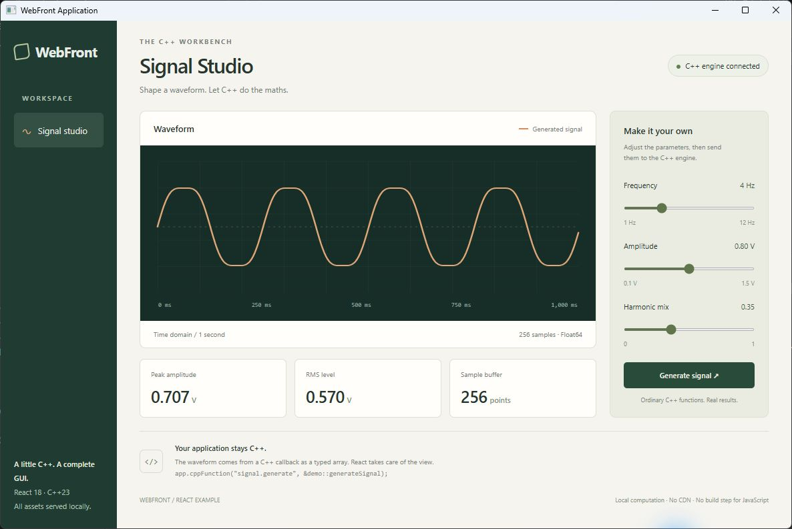
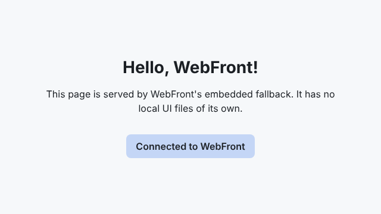

# WebFront

**A straightforward way to add a cross-platform GUI to your C++ application.**

WebFront is a header-only C++23 graphical user interface library for Windows, Linux and macOS. Keep your application logic in C++, design the interface with HTML and CSS, and connect the two with ordinary C++ callbacks. Start with a few lines, then build the interface your application needs.

Your application keeps its own types and ownership model. There is no required base class for application objects, no meta-object compiler and no application-wide event loop to adopt. WebFront runs its server on a background thread; the chosen frontend handles displaying the interface. [How it fits your application](#how-it-fits-your-application) explains the threading and lifetime details.



*Signal Studio, running in a native WebView2 application window. C++ generates the samples; the embedded React draws the waveform and provides the controls. No browser tabs, CDN or JavaScript build step. [Try the example](#signal-studio-the-react-example).*

Use your existing browser to get started, or choose an embedded application window. The simplest example needs no HTML, JavaScript, Node.js, bundler or separately managed web server.

**WebFront is experimental.** The examples work and the bridge is tested across platforms, but APIs and packaging are still developing. Read the [limitations](#limitations) before choosing it for a released product.

[Get started](#hello-world) · [Connect your interface to C++](#connect-your-interface-to-c) · [Add it to your project](#use-webfront-in-your-project) · [Choose a window](#choose-how-your-interface-opens)

## Hello World

```cpp
#include <WebFront.hpp>

using App = webfront::WebFront;

int main() {
    App app;
    app.show();
}
```

That is the complete program (`src/HelloWorld.cpp`). Build it with the classic CMake workflow; it needs no options and downloads neither Chromium nor a test framework:

```bash
git clone https://github.com/ambroise-leclerc/WebFront.git
cd WebFront
mkdir build
cd build
cmake ..
cmake --build .
```

Then launch it from the build directory:

```bash
./src/HelloWorld
```

Your system browser opens the interface below. The page is included in the library, so there are no assets to prepare. **Connected to WebFront** confirms that the interface has connected to your C++ application. Press Enter in the terminal to stop the server.



## Connect your interface to C++

For a small first example, the Greeter connects a name field and a button to application code. Register an ordinary C++ lambda; WebFront deduces its signature:

```cpp
App app{webfront::WebFrontConfig{.documentRoot = "src/greeter"}};

app.cppFunction("greet", [](std::string name) {
    return "Hello, " + name + "!";
});

app.show();
```

The document root is an explicit, development-only opt-in: WebFront then serves the files of that directory (here `src/greeter/index.html`) instead of the fallback page. Without a document root WebFront performs no local file access at all.

The page is plain HTML plus one native JavaScript module (`src/greeter/greeter.mjs`). It waits for the bridge, then awaits the Promise that `cppFunction` returns:

```js
await webFront.ready;                         // resolves after the WebSocket handshake
const greet = webFront.cppFunction("greet");
const message = await greet("Ada");           // "Hello, Ada!" computed in C++
result.textContent = message;
```

Run it from the build directory (the build copies the assets to `src/greeter`):

```bash
./src/WebFrontGreeter
```

Exceptions thrown by the C++ callback reject the JavaScript Promise. `webFront.ready` rejects if the initial connection fails or closes; it does not report later disconnects.

Callback signatures are deduced for ordinary and `mutable` lambdas, function pointers and `std::function`. Generic lambdas and overloaded call operators cannot be deduced; register those with `app.cppFunction<ReturnType, Args...>(name, callable)`.

## How it fits your application

Keep calculations, data structures and resource ownership in C++. The interface calls the functions you register, and C++ can call back into the interface. There is no requirement to make your application objects inherit from a widget hierarchy or adopt a parent-owned object model.

The connection is asynchronous: interface code awaits a Promise when it calls C++, and C++ can request a result through `std::future`. WebFront owns its server thread and cleans it up when the application object is destroyed. Callbacks run on that server thread; synchronise access to shared application state and hand lengthy work to your own workers.

`show()` starts the server and opens the interface. It is a blocking call: the default frontend waits for Enter in the terminal, while an embedded frontend runs its window loop until the window closes. Embedded frontends also have platform thread requirements; WebView2 normally belongs on the main thread. You do not write a GUI event loop, but you still need to choose where `show()` belongs in your application's lifecycle.

For a command-line tool, this can mean adding a graphical control panel around existing functions. For an interactive application, it gives you HTML and CSS for layout while your C++ code continues to own the work. See [Bridge basics](#bridge-basics) for return values, errors and connection handling.

## A terminal for your application

`WebFrontTerminal` adds an interactive terminal to your application's interface. Its embedded [xterm.js](https://xtermjs.org/) line editor provides history and Tab completion, and sends each line to commands registered in C++. It is the first optional UI component; it needs no document root or internet access at run time.

```cpp
#include <components/Terminal.hpp>

webfront::TerminalApp app;
webfront::Terminal terminal{app, {.prompt = "demo> "}};
terminal.command("greet", "Greet someone", [](webfront::CommandArgs args) {
    return "Hello, " + (args.empty() ? std::string{"world"} : args[0]) + "!";
});
app.show(terminal.page);
```

A command's return value (or what it writes to a `std::ostream&` parameter) is printed; an exception is shown as an error. `help` and `clear` are built in. Output appears when the command finishes: there is no streaming, and Ctrl+C interrupts only browser commands. See [docs/UI_COMPONENTS.md](docs/UI_COMPONENTS.md) for the component architecture and the `wf` tool manager.

```bash
./src/WebFrontTerminal
```

`WebFrontTools` (`src/Tools.cpp`) adds the `wf` tool manager to the terminal: `wf search`, `wf install <package>[@version]`, `wf list`, `wf open` and `wf remove` manage web tools published on npm with the `webfront-tool` keyword. The page downloads them from registry.npmjs.org, checks their SHA-512 integrity and stores them in the working directory (`.webfront/tools/`, recorded in `webfront-tools.lock.json`). An installed tool can call every registered C++ function: install only tools you trust, during development.

## Choose how your interface opens

The application code and interface assets stay the same whichever frontend you select.

| Frontend | Platforms | What you need |
| --- | --- | --- |
| System browser (default) | Windows, Linux, macOS | An installed browser; no embedded engine download |
| Embedded CEF window | Windows, Linux, macOS | Enable CEF at configuration time; a large download |
| Embedded WebView2 window | Windows | Enable the SDK and install the Evergreen Runtime |

Every frontend follows the same contract (threading, blocking, errors); see [Frontends](docs/FRONTENDS.md).

### Embedded window with CEF (opt-in)

By default WebFront opens your system browser. To get an application window instead, enable the Chromium Embedded Framework when configuring. CEF is a **large download** and is never fetched unless you ask for it:

```bash
cmake -DWEBFRONT_EMBED_CEF=ON ..
```

`WEBFRONT_EMBED_CEF` only makes CEF *available*; the frontend is chosen in your source by changing the alias, nothing else:

```cpp
using App = webfront::WebFrontWithFrontend<webfront::frontend::CEFFrontend>;
```

Selecting `CEFFrontend` in a build without CEF fails with a clear error. An embedded window stops the server when it closes. `webfront::WebFront` always uses the system browser, even in a CEF-enabled build.

### Embedded window with WebView2 (Windows, opt-in)

Configure with `-DWEBFRONT_EMBED_WEBVIEW2=ON`, then select the frontend explicitly:

```cpp
using App = webfront::WebFrontWithFrontend<webfront::frontend::WebView2Frontend>;
App app;
app.show(); // returns when the window closes and the server has stopped
```

CMake fetches Microsoft.Web.WebView2 SDK **1.0.3537.50**, verifies its SHA-256 and links the static loader; no machine-wide SDK or loader DLL is required. The option defaults to `OFF` and requires Windows with an MSVC-compatible compiler (MSVC or clang-cl); MinGW is rejected at configuration time. The loader follows the compiler's x86, x64 or ARM64 target, including when it differs from the host; unsupported targets fail during configuration. It never changes `webfront::WebFront`'s system-browser default. Selecting the adapter without support throws an error explaining how to enable it.

The separately installed **Microsoft Edge WebView2 Evergreen Runtime** is required. Call `show()` on an STA-compatible thread, normally the main thread. The window handles resizing and keyboard focus, and closing it stops the server.

This frontend currently targets development with trusted content. Navigation and popups are unrestricted; DevTools and context menus remain available. See the [WebView2 frontend notes](docs/WEBVIEW2.md) for runtime distribution, configurable startup deadlines and profiles, DPI and the navigation policy.

## Use WebFront in your project

```cmake
cmake_minimum_required(VERSION 3.31)
project(MyApp LANGUAGES CXX)

add_subdirectory(WebFront)              # e.g. a git submodule or a vendored checkout
add_executable(MyApp main.cpp)
target_link_libraries(MyApp PRIVATE WebFront::WebFront)
```

When WebFront is not the top-level project it builds neither its examples nor its tests (opt in with `-DWEBFRONT_BUILD_EXAMPLES=ON` or `-DENABLE_TESTING=ON`). Dependencies are fetched with CPM during the first configure, so that step needs network access. There is no installable CMake package yet.

## Limitations

- WebFront is an experimental foundation. APIs and the wire format may change.
- Calls are asynchronous. Results cross the bridge as `std::future` (C++ calling JavaScript, `ui.jsFunction<R>(name)`) and Promises (JavaScript calling C++, `webFront.cppFunction(name)`), limited to scalars, strings (up to 65535 bytes each), tuples and numeric typed arrays. Richer objects and a DOM abstraction are out of scope.
- A configured document root exposes local files for **development only**; it is not a sandbox or a production packaging format.
- Nothing authenticates the browser: the server binds to loopback by default, but any local process can connect.
- With WebView2 enabled, `WebFront.hpp` exposes Windows SDK, Shell and WRL global names, including `::byte`. Qualify `std::byte` instead of relying on `using namespace std;`.
- The tested toolchains are listed in the CI workflow; other compilers may not work yet.

## Build options

| Option | Default | Meaning |
| --- | --- | --- |
| `WEBFRONT_EMBED_CEF` | `OFF` | Download and link CEF so `CEFFrontend` is available |
| `WEBFRONT_EMBED_WEBVIEW2` | `OFF` | Download the pinned WebView2 SDK and link its static loader (Windows only) |
| `WEBFRONT_DEMO_FRONTEND` | `DefaultBrowser` | Frontend for `WebFrontApp`: `DefaultBrowser`, `CEF` or `WebView2` (enable the matching SDK) |
| `WEBFRONT_WEBTEST_FRONTEND` | `WebView2` when enabled, otherwise `CEF` | Embedded frontend for the shared Jasmine runner |
| `ENABLE_TESTING` | `OFF` | Build the Catch2 suite and the Jasmine browser test |
| `WEBFRONT_BUILD_EXAMPLES` | `ON` when top-level | Build `HelloWorld`, `WebFrontGreeter` and `WebFrontApp` |
| `ENABLE_COVERAGE` | `OFF` | Instrument the C++ tests (GCC/Clang) |

## Contributing: build and test

```bash
cmake -S . -B build -DCMAKE_BUILD_TYPE=Release \
  -DWEBFRONT_EMBED_CEF=OFF -DENABLE_TESTING=ON
cmake --build build --parallel
ctest --test-dir build --output-on-failure
```

The automated real-browser test runs on Linux with Xvfb:

```bash
cmake -S . -B build-cef -DCMAKE_BUILD_TYPE=Release \
  -DWEBFRONT_EMBED_CEF=ON -DENABLE_TESTING=ON
cmake --build build-cef --target webtest --parallel
ctest --test-dir build-cef -L web-integration --output-on-failure
```

The Jasmine specs are native ES modules. They prove relative module loading, both bridge directions, all supported numeric typed arrays and `webFront.ready`; report the final result to C++; close the embedded window automatically; and fail CTest on an assertion, bridge, startup or timeout error. CTest also checks that the commands and snippets in this README match the built examples.

On Windows, the same Jasmine suite and additional lifecycle tests run in WebView2 (Evergreen runtime required):

```powershell
cmake -S . -B build-webview2 -DWEBFRONT_EMBED_WEBVIEW2=ON -DWEBFRONT_EMBED_CEF=OFF -DENABLE_TESTING=ON -DWEBFRONT_DEMO_FRONTEND=WebView2
cmake --build build-webview2 --config Release --parallel
ctest --test-dir build-webview2 -C Release --output-on-failure
```

The `windows-2025` CI matrix includes both the default MSVC build and this WebView2 configuration. Every browser test has a CTest timeout. Lifecycle tests cover repeated opening, closure requested during native window creation, queued startup timer messages after closure or failure, a held page resource after runtime creation, a page that never connects, a rejected `webFront.ready`, initial and later failed navigation, incompatible COM and a missing runtime. Unit tests cover shared URL construction, configured addresses and deadlines, process-failure policy, native focus/move/DPI forwarding, reentrant shutdown and hexadecimal HRESULT diagnostics.

The shared Jasmine suite also runs the actual Signal Studio React interface against its C++ callback, including parameter changes and recovery after a failed call. Unit tests check the generated samples and parameter validation.

CI runs the WebView2 browser label separately with `--no-tests=error`, so absent browser tests fail the job. Runtime provisioning uses Microsoft's mutable Evergreen bootstrapper redirect, verifies its Microsoft signature if downloaded, and logs installed executable versions. The runtime is intentionally not pinned; the browser suite verifies initialisation with the selected runtime.

## Signal Studio: the React example

[Signal Studio](src/react.html) is the application pictured above. Adjust the frequency, amplitude and harmonic mix, then generate a new waveform. An ordinary [C++ function](src/SignalDemo.hpp) calculates 256 samples and returns a numeric typed array; React renders the curve and derives its peak and RMS measurements. The data is synthetic, rather than a live device feed.

React 18, ReactDOM and Babel are served from WebFront's embedded resources. The example needs no npm install, CDN or separate JavaScript build. Babel translates the small JSX interface at run time for this development example.

To open it in a native window on Windows, configure from the repository root (WebView2 Evergreen Runtime required):

```powershell
cmake -S . -B build-webview2 -DWEBFRONT_EMBED_WEBVIEW2=ON -DWEBFRONT_DEMO_FRONTEND=WebView2
cmake --build build-webview2 --config Release --target WebFrontApp
./build-webview2/src/Release/WebFrontApp.exe react.html
```

This is how the screenshot was captured: the real application in its WebView2 window, including the Windows title bar and window controls. [CEF](#embedded-window-with-cef-opt-in) is the other embedded option; select `-DWEBFRONT_DEMO_FRONTEND=CEF` with CEF enabled. In the default build, launch `./src/WebFrontApp react.html` from the build directory to use the system browser instead.

## Native-module demo

Without a page argument, `WebFrontApp` serves `src/module-demo.html`, whose entry module imports other `.mjs` files with relative URLs, calls the registered C++ `moduleReady` callback and receives a C++ call back:

```bash
./src/WebFrontApp               # native-module demo
./src/WebFrontApp react.html    # Signal Studio (embedded React)
```

## Bridge basics

Built-in frontends open the configured server address. Page arguments are URI references: `app.show("index.html?view=details#result")` preserves the query and fragment. Spaces and UTF-8 characters are encoded automatically; use `%23`, `%3F` and `%25` for literal `#`, `?` and `%` in a filename. Existing percent escapes are preserved consistently across frontends.

- The two directions differ. JavaScript obtains a registered callback with `webFront.cppFunction('name')` and calls C++; the call always returns a Promise, even for a `void` C++ callback, so await it or handle its rejection (an ignored rejected Promise raises an unhandled rejection).
- C++ obtains a browser function with `ui.jsFunction("name")` and calls served JavaScript. Only the untyped form is fire-and-forget; `ui.jsFunction<R>(name)(...)` returns a `std::future<R>`.
- Bridge parameters include scalars, strings, tuples and numeric typed arrays. C++ `std::vector`, `std::array` and `std::span` map to the matching JavaScript typed-array class; ordinary JavaScript arrays remain tuple-like argument groups.
- Missing functions, callback exceptions, malformed returns and disconnected browsers complete a C++ future exceptionally (`get()` throws) and reject a JavaScript Promise.
- A callback whose first parameter is the application's `UI` type receives the browser that called it, for example to call it back later; JavaScript passes only the other parameters:
  ```cpp
  app.cppFunction("subscribe", [](webfront::UI caller, std::string topic) {
      caller.jsFunction("onEvent")(topic);
  });
  ```
- `onUIStarted(handler)` sets the application's handler for each connected browser. Code that must not replace it, such as a reusable component, uses `auto subscription = app.subscribeUIStarted(handler);`; the handler stays registered while `subscription` lives.

## Advanced: frontend aliases

```cpp
using BrowserFront = webfront::WebFrontWithFrontend<webfront::frontend::DefaultBrowserFrontend>;
using EmbeddedFront = webfront::WebFrontWithFrontend<webfront::frontend::CEFFrontend>;
using WindowsFront = webfront::WebFrontWithFrontend<webfront::frontend::WebView2Frontend>;
```

See [AGENTS.md](AGENTS.md) for architecture, development commands, conventions, test requirements and safety guidance. The current evidence-based status and backlog recommendations are in [docs/PROJECT_STATUS.md](docs/PROJECT_STATUS.md) and [docs/ISSUE_AUDIT.md](docs/ISSUE_AUDIT.md).

Optional mddlog diagnostics are available through `WEBFRONT_USE_MDDLOG=ON` (default: `OFF`). Consumers keep including `tooling/Logger.hpp`; WebFront links its compiled adapter. See [dependencies, toolchain matrix and verification](docs/mddlog-integration.md).
