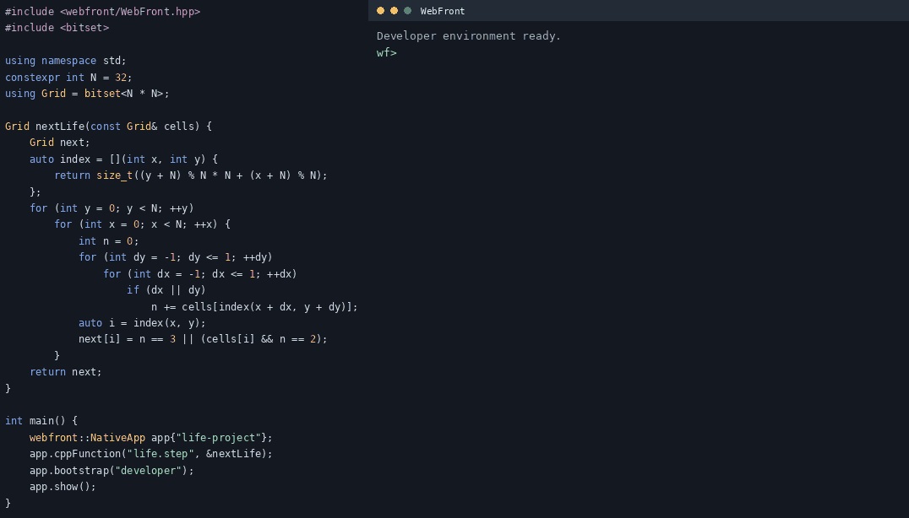

#  WebFront

[](https://github.com/ambroise-leclerc/WebFront/actions/workflows/BuildAndTest.yml)
[](https://github.com/ambroise-leclerc/WebFront/actions/workflows/BuildAndTest.yml)
[](https://github.com/ambroise-leclerc/WebFront/actions/workflows/BuildAndTest.yml)
[](https://github.com/ambroise-leclerc/WebFront/actions/workflows/BuildAndTest.yml)
[](CMakeLists.txt)
[](include/)

**WebFront is a header-only C++23 library for building rich, modern user interfaces.**
Keep application logic in C++ and create reactive interfaces with TypeScript, React and the existing JavaScript package ecosystem. WebFront brings the UI tools into your application: there is no separate JavaScript development environment to install.

## From C++ to a reactive UI

Register your simulation, bootstrap the tools, then build the interface in the application's terminal. `life-project` is the working directory for the UI sources:

<a href="#game-of-life-from-console-to-native-application"></a>

<details>
<summary>The C++ application of the animation, as text</summary>

```cpp
#include <webfront/WebFront.hpp>
#include <bitset>

using namespace std;
constexpr int N = 32;
using Grid = bitset<N * N>;

Grid nextLife(const Grid& cells) {
    Grid next;
    auto index = [](int x, int y) {
        return size_t((y + N) % N * N + (x + N) % N);
    };
    for (int y = 0; y < N; ++y)
        for (int x = 0; x < N; ++x) {
            int n = 0;
            for (int dy = -1; dy <= 1; ++dy)
                for (int dx = -1; dx <= 1; ++dx)
                    if (dx || dy)
                        n += cells[index(x + dx, y + dy)];
            auto i = index(x, y);
            next[i] = n == 3 || (cells[i] && n == 2);
        }
    return next;
}

int main() {
    webfront::NativeApp app{"life-project"};
    app.cppFunction("life.step", &nextLife);
    app.bootstrap("developer");
    app.show();
}
```

</details>

The animation shows the C++ application and the Game of Life example, with terminal output and timing condensed and the preview expanded for readability. [Follow the walkthrough below ↓](#game-of-life-from-console-to-native-application)

## Game of Life: from console to native application

The example starts with a C++ simulation, adds a React interface, then embeds that interface in the executable. You need Git, CMake **3.31+** and a C++23 compiler. The initial CMake configuration, the first bootstrap and the first `wf install` need internet access; afterwards the downloaded environment and packages are cached and can be verified offline.

```bash
git clone https://github.com/ambroise-leclerc/WebFront.git
cd WebFront
mkdir build
cd build
cmake ..
cmake --build .
```

No option is needed: the build enables this platform's native window engine when its dependencies are found (see [step 2](#2-add-a-window-and-bootstrap-the-tools)). The commands below start from this `build` directory. With a multi-configuration generator such as Visual Studio, executables are in `examples\Debug\` (`--config Release` selects `examples\Release\`).

### 1. Start with the C++ simulation

[Life.hpp](examples/life/Life.hpp) implements Conway's B3/S23 rules on a wrapping 32 × 32 grid. Each step creates a new `std::bitset<1024>`. [LifeConsole.cpp](examples/life/LifeConsole.cpp) runs it without a GUI:

```bash
examples/WebFrontLifeConsole
```

On Windows with Visual Studio run `examples\Debug\WebFrontLifeConsole.exe`.

### 2. Add a window and bootstrap the tools

The essential change in [LifeDeveloper.cpp](examples/life/LifeDeveloper.cpp) is:

```cpp
#include "LifeFrontend.hpp"

webfront::demo::LifeApp app{"life-project"};
app.cppFunction("life.step", &webfront::demo::nextLife);
app.bootstrap("developer");
app.show();
```

The project directory gives the application access to its development files. `bootstrap("developer")` opens the integrated terminal and loads the version-pinned developer environment, checking its SHA-512 integrity. Downloads are cached, so later launches work offline. The terminal runs `wf` commands; no system shell is exposed and nothing is installed on your machine.

The build you made above is enough. Start the example from the `build` directory:

```bash
examples/WebFrontLifeDeveloper
```

On Windows with Visual Studio run `examples\Debug\WebFrontLifeDeveloper.exe`. Without argument, the example uses `life-project` in the current directory (`build/life-project`), creates it when it is missing and reuses an existing one without touching its files; every `life-project/...` path below is relative to it. The pinned environment is used.

**Native window.** At configuration, CMake enables the native engine of your platform when it finds its dependencies, with no option to pass:

| Platform | Engine | Detected when |
| --- | --- | --- |
| Windows | Microsoft Edge WebView2 Evergreen | an MSVC-compatible compiler is used (the SDK is downloaded; the Evergreen runtime is checked at start) |
| macOS 13.3+ | System Cocoa / WebKit | Clang and a deployment target of at least 13.3 |
| Linux | WebKitGTK 6.0 | `pkg-config webkitgtk-6.0` succeeds; [installation](docs/WEBKITGTK.md) |

On macOS, this opens a WKWebView window using the system Cocoa and WebKit frameworks, with no engine download.
The example constructs the application and calls `show()` on the main thread; the HTTP/WebSocket server runs on its own thread.
Closing the window stops the server and exits the example. An explicit deployment target below 13.3 disables automatic detection;
explicitly enabling WKWebView with such a target fails configuration. See [the macOS guide](docs/WKWEBVIEW.md).

When the engine is missing, configuration still succeeds. CMake prints a `Native window: no native engine will be built` notice that says what to install, and `WebFrontLifeDeveloper` is compiled for the default browser: at start it prints that notice, serves the same application and opens it in your system browser. Install the dependency and run `cmake ..` again to get the native window. CEF (`-DWEBFRONT_EMBED_CEF=ON`) makes `CEFFrontend` available to your own applications; the examples do not select it.

**Advanced options.**

- Choose the engine yourself with `-DWEBFRONT_EMBED_WEBVIEW2=ON|OFF`, `-DWEBFRONT_EMBED_WKWEBVIEW=ON|OFF` or `-DWEBFRONT_EMBED_WEBKITGTK=ON|OFF`; an explicit value is never replaced by the detection. `-DWEBFRONT_AUTODETECT_NATIVE=OFF` disables it. Test builds (`-DENABLE_TESTING=ON`) keep the explicit selection.
- Automatic engine choices are recalculated on each configuration and do not create an engine option in the cache. To return from an explicit macOS choice to automatic detection, run `cmake .. -UWEBFRONT_EMBED_WKWEBVIEW` (or remove the corresponding engine option on another platform).
- Another project directory, and another environment archive, can be passed: `examples/WebFrontLifeDeveloper <project> [<environment-url> <sha512-integrity>]`, for instance an environment [built from the sources](docs/DEVELOPER_ENVIRONMENT.md#environment-distribution-and-offline-tests-maintainers).

The example reports startup failures with a nonzero exit status.

### 3. Create the project and install its dependencies

In the application's terminal, run:

```text
wf create life
wf init
wf install react@19.3.1 react-dom@19.3.1
wf dev ui/main.tsx
```

- `wf create life` writes the editable [TSX and CSS starter](examples/life/ui) into `ui/`; it never overwrites an existing directory.
- `wf init` writes `webfront.project.json`, the manifest every other command reads: dependencies, entries, providers, scripts and permissions.
- `wf install` resolves the packages and their dependencies from the registry, verifies their integrity and records exact versions in `webfront-packages.lock.json`. It does not run the installation scripts of packages. `wf restore` rebuilds the cache from the lock on another machine, and `wf restore --offline` verifies it without any network.
- `wf dev` compiles the TSX with esbuild-wasm, opens the interface inside the application and rebuilds it whenever you save a source. A build error appears in the terminal and over the preview, which keeps its last good version. Ctrl+C stops it; `wf build` compiles once without opening anything.

Edit `life-project/ui/main.tsx` and `style.css` with your usual editor. React renders the field and controls; each generation awaits the C++ callback:

```js
await webFront.ready;
const step = webFront.cppFunction('life.step');
const next = await step(cells);
```

`cells` and `next` are 128-byte `Uint8Array` grids mapped to C++ `std::bitset<1024>`, least-significant bit first in each byte. JavaScript calls always return a Promise: await them or handle rejection. No Life rules run in JavaScript.

### 4. Run the tests and check the types

`wf test` runs your [Jasmine](https://jasmine.github.io/) specs in the application's window, under the `jasmine-core` your lock pins. Install it, create `life-project/tests/life.spec.js` and list it in `webfront.project.json` (`wf init` does not copy the starter's recipe, so the manifest only holds what you add):

```js
describe('the Life grid', () => {
    it('packs 32 by 32 cells into 128 bytes, least significant bit first', () => {
        const cells = new Uint8Array(32 * 32 / 8);
        for (const i of [330, 331, 332]) cells[i >> 3] |= 1 << (i & 7);
        expect(cells.length).toBe(128);
        expect(cells[41]).toBe(0b00011100);
    });
});
```

```text
wf install jasmine-core@7.0.2
```

```json
"test": {"specs": ["tests/life.spec.js"]}
```

```text
wf test
```

The command ends with a nonzero code when a spec fails.

The builds remove TypeScript types without checking them; `wf check` runs the TypeScript compiler that your lock pins, in the browser. It needs a `tsconfig.json` and the type packages of your imports. A complete one for the starter, the same as the journey tests use, is:

```json
{
  "compilerOptions": {
    "strict": true,
    "target": "ES2022",
    "module": "ESNext",
    "moduleResolution": "Bundler",
    "jsx": "react-jsx",
    "lib": ["ES2022", "DOM", "DOM.Iterable"],
    "noEmit": true
  },
  "include": ["ui"]
}
```

The type packages come next: `wf install typescript@5.9.3 @types/react@19.3.0 @types/react-dom@19.3.0` then `wf check` type-check the starter. Both commands are described in the [developer environment reference](docs/DEVELOPER_ENVIRONMENT.md).

### 5. Try the result


Play or pause, advance one generation, paint cells, switch patterns, change speed or select a plan view. Generation and population counters reflect the C++ simulation. Only one generation request is outstanding at a time; failures stop playback and appear in the interface.

### 6. Embed the interface for distribution

Declare the entry and the provider in `webfront.project.json` (`"entries": {"main": "ui/main.tsx"}` and `"providers": {"LifeUI": {"entry": "main", "output": "generated/LifeUI.hpp"}}`), or pass them explicitly. In the application's terminal:

```text
wf embed ui/main.tsx --output generated/LifeUI.hpp
```

This builds the interface and packages its resources and dependency notices into a compressed C++ header. Close the development window, then reconfigure the same `build` directory (the engine is kept):

```bash
cmake .. -DWEBFRONT_LIFE_ASSETS="$PWD/life-project/generated/LifeUI.hpp"
cmake --build . --target WebFrontLifeEmbedded
examples/WebFrontLifeEmbedded
```

For Visual Studio launch `examples\Debug\WebFrontLifeEmbedded.exe`.

[LifeEmbedded.cpp](examples/life/LifeEmbedded.cpp) replaces the development project and bootstrap with the generated provider:

```cpp
#include "LifeFrontend.hpp"

webfront::demo::LifeAppWithAssets<webfront::fs::LifeUI> app;
app.cppFunction("life.step", &webfront::demo::nextLife);
app.show();
```

Recompilation is explicit. The resulting application runs offline without the project directory, developer callbacks or downloaded tool cache. The selected native engine's deployment requirements still apply; this is not an application installer.

The examples' [LifeFrontend.hpp](examples/life/LifeFrontend.hpp) selects the native engine or the default browser for both stages.
Your own application can select `webfront::NativeApp` or `webfront::NativeAppWithAssets` explicitly when it requires a native window.

## Use WebFront in your project

WebFront's implementation lives under `include/`. There is no WebFront library binary to build; CMake supplies its C++ dependencies and platform settings:

```cmake
add_subdirectory(path/to/WebFront)
add_executable(MyApp main.cpp)
target_link_libraries(MyApp PRIVATE WebFront::WebFront)
```

As a subproject, examples and tests are off by default and compiler settings do not leak into your targets. `WEBFRONT_BUILD_EXAMPLES=OFF` disables examples in a standalone build too.

`webfront::WebFront` always uses the system browser. Native adapters remain optional: the examples enable the one of your platform when its dependencies are found, while your own application selects its frontend explicitly; CEF is available when you need an embedded Chromium distribution. See [WKWebView](docs/WKWEBVIEW.md), [WebKitGTK](docs/WEBKITGTK.md) and the [frontend architecture](docs/adr/README.md).

## Build and test

```bash
cmake -S . -B build -DCMAKE_BUILD_TYPE=Release \
  -DWEBFRONT_EMBED_CEF=OFF -DENABLE_TESTING=ON
cmake --build build --parallel 2
ctest --test-dir build --output-on-failure --parallel 4
```

Configuring with tests enabled downloads, and verifies against their SHA-512, the pinned bootstrap environment and the packages of the test registry; the embedded assets are generated and checked by CMake alone (the `webfront-embedded-assets` target regenerates them). Normal C++ builds use versioned headers. Browser tests require an enabled engine; Linux CEF tests use Xvfb. See [AGENTS.md](AGENTS.md) for contributor commands and [developer environment testing](docs/DEVELOPER_ENVIRONMENT.md#environment-distribution-and-offline-tests-maintainers).

CTest runs up to four tasks at a time; independent driver sessions use OS-assigned ports, while
shared projects and nested builds retain resource locks.
See [test timings and parallelism](docs/TEST_PERFORMANCE.md) for measurements and constraints.
`ctest -L fast` runs the unit tests in about a second; [test tiers](docs/TEST_TIERS.md) describes what CI runs on each pull request, weekly and before a merge into `master`.

CI runs one combined C++ / native-browser job per desktop platform on each code change. The Linux job also collects and prints GCC line coverage (no external upload). Linux Clang, sanitizers, fuzzing and CEF compatibility run weekly, on demand and on pull requests into `master`. Manual dispatch with `repeat_desktop_tests=true` also runs the complete desktop CTest suite three times, recreating its fixtures on each pass. Workflow concurrency cancels superseded runs; dependency and compiler caches avoid repeated work. Platform badges above identify the configured matrix; the CI badge reports its aggregate status. Execution times depend on cache state and runner availability.

## Contracts and limitations

- WebFront owns an HTTP/WebSocket server on a background thread. Callbacks run there; avoid blocking it. Native windows must be created and shown on the main thread. Application coroutines use `app.spawn(task)` or `ui.spawn(task)`; see [execution and cancellation](docs/ASYNC_EXECUTION.md).
- JavaScript calls to C++ always return Promises. C++ `ui.jsFunction(name)(...)` is fire-and-forget; `ui.jsFunction<R>(name)(...)` returns `std::future<R>`. Missing functions, exceptions, malformed replies and disconnects fail the typed call.
- The binary bridge supports scalars, strings, tuples, numeric typed arrays and packed bitsets. Arbitrary objects do not cross it. Strings have a 16-bit encoded length limit.
- Development project access is explicit and intended for trusted local code. Downloaded tools run with the application's bridge authority, and script permissions frame only the `context` API: neither is a sandbox. Only packages that run in a browser are supported; installation scripts and native add-ons are not executed. Builds transform TypeScript without type checking; `wf check` type-checks with the compiler the project locks.
- The optional [`@webfront/react` adapter](docs/REACT.md) supplies coalesced C++ stores and empty React islands. `WebFrontLifeReact` demonstrates a C++ panel within the Game of Life React UI; its package archive is prepared locally for registry publication.
- Packaging, accessibility and native-engine deployment still need application-specific work. The optional [`ui.document()` API](docs/DOM.md) provides DOM islands, automatically batched writes, event callbacks and grouped sender reads. See [project status](docs/PROJECT_STATUS.md) for known limitations.

## License

WebFront is dual-licensed under **Apache-2.0 OR CECILL-B**, at your option.
You may use, modify and redistribute WebFront under either license; you do not
need to comply with both simultaneously. See [LICENSE](LICENSE) for the full
Apache 2.0 and CeCILL-B version 1 texts, including the French and English
versions of CeCILL-B.

Third-party components retain their own licenses and notices. The WebFront
license choice does not replace the licenses of its dependencies or bundled
third-party code.

[Developer environment reference](docs/DEVELOPER_ENVIRONMENT.md) · [architecture decisions](docs/adr/README.md) · [contributing](.github/CONTRIBUTING.md)
