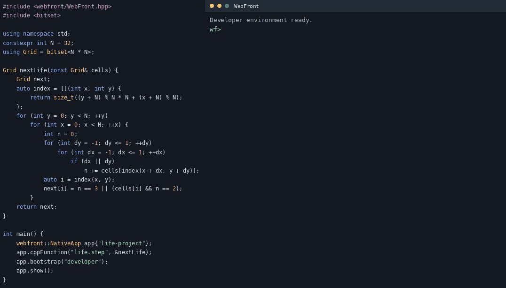
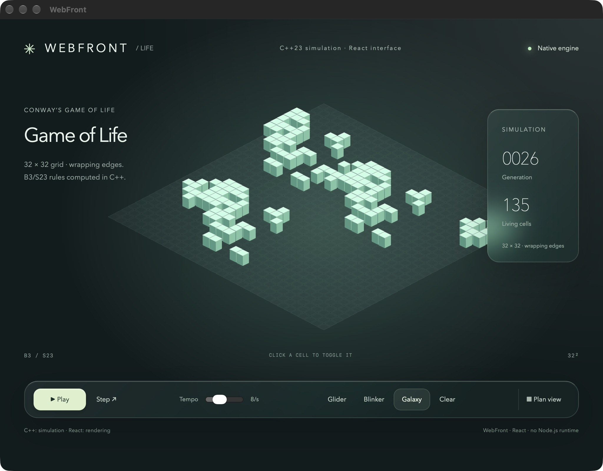

#  WebFront

[English](README.md) · [Français](README.fr.md) · [简体中文](README.zh-CN.md)

给 C++ 程序加上现代界面，再把整个应用打包成一个可执行文件。WebFront 是一个纯头文件的 C++23 库。应用逻辑留在 C++ 中，响应式界面可以用 TypeScript、React 和兼容浏览器的第三方包来构建。

调用 `app.bootstrap("developer")`，应用就能打开自己的开发环境。在应用窗口中，`wf` 可以编译和预览界面、检查类型，并运行 Jasmine 测试。你可以在终端里操作，也可以让编程智能体通过 MCP 执行同样的流程。无需安装 Node.js 或 npm。

界面准备就绪后，将资源嵌入可执行文件。这样就能得到一个紧凑、自包含的应用，可在原生窗口中离线运行，也可在嵌入式系统和无显示器的系统上通过 Web 浏览器离线使用。

[](#从-c-模拟到可分发的生命游戏)

- **让编程智能体参与开发。** 智能体可通过 MCP 创建界面、安装依赖、预览、测试并嵌入资源。在你授予的权限范围内，它还可以检查正在运行的应用、操作界面并调用指定的 C++ 函数。
- **锁定开发依赖。** 开发环境固定版本，经 SHA-512 校验后在首次使用时缓存。项目清单和锁文件记录团队与智能体共同使用的依赖。
- **为现有 C++ 软件添加界面。** 保留事件循环、工作线程、设备控制和 SIMD 或 CUDA 计算。界面可以打开在原生窗口或系统浏览器中，也可以并行运行多个应用或窗口。见[宿主集成指南](docs/HOST_INTEGRATION.md)。
- **直接传输数值数据。** 类型化数组和压缩位集通过二进制 WebSocket 桥接传输，无需转换成 JSON 或 Base64。见[异步执行模型](docs/ASYNC_EXECUTION.md)。
- **自由选择界面技术。** 可以使用 React，也可直接用 C++ 创建 [DOM 岛](docs/DOM.md)，或根据 C++ 类型描述生成[表单和检查器](docs/FORMS.md)。

## 平台与部署

| 平台 | 界面选项 |
| --- | --- |
| Windows | 系统浏览器、WebView2 Evergreen、可选 CEF |
| macOS | 系统浏览器、macOS 13.3 及以上版本的 WKWebView、可选 CEF |
| Linux | 系统浏览器、WebKitGTK 6.0、可选 CEF |
| Linux ARM64 / NVIDIA Jetson | 系统浏览器，以及目标系统提供的 WebKitGTK 或 CEF |

选用原生引擎时，部署仍需满足该引擎的系统要求。关于编译器、CI 覆盖和 Jetson 真机验证，请参阅[项目状态](docs/PROJECT_STATUS.md)、[前端选择](docs/FRONTENDS.md)和 [Jetson 指南](docs/JETSON.md)。

## 与编程智能体协作

将界面源文件放在项目的 `ui/` 目录下。在应用窗口中运行 `wf create app`、`wf init` 和 `wf install <package>`，然后用 `wf dev ui/main.ts` 边改边看。准备交付时，运行 `wf check`、`wf test` 和 `wf embed`。

开发版应用通过 `webfront::automation::enableAutomation(app, {.grants = {...}})` 启用 MCP。应用本身就是 MCP 服务端，会输出地址以及私有客户端配置 `mcp.json` 的路径。智能体通过 `webfront.start` 发起已获授权的操作，再用 `webfront.result` 读取结果。令牌应保存在项目目录之外。连接方式和权限配置见[智能体开发指南](docs/DEVELOPING_WITH_AGENTS.md)及[自动化参考](docs/AUTOMATION.md)。

## Hello World

最小示例会提供内置页面，并用系统浏览器打开它。见 [HelloWorld.cpp](examples/hello-world/HelloWorld.cpp)。

```cpp
#include <webfront/WebFront.hpp>

int main() {
    webfront::WebFront app;
    app.show();
}
```

需要 Git、CMake **3.31+** 和支持 C++23 的编译器。首次配置、首次启动开发环境和首次安装包需要联网。下载完成后，开发环境和依赖会保留在缓存中。见[编译器支持策略](docs/adr/ADR-022-profils-et-niveaux-de-support.md)及 [LTS 发行版构建工具](README.md#build-tools-on-lts-distributions)。

```bash
git clone https://github.com/ambroise-leclerc/WebFront.git
cd WebFront
mkdir build
cd build
cmake ..
cmake --build .
./examples/HelloWorld
```

使用 Visual Studio 的多配置生成器时，运行 `examples\Debug\HelloWorld.exe`。如需 Release 版本，构建时传入 `--config Release`，再从 `examples\Release\` 启动。

## 从 C++ 模拟到可分发的生命游戏

生命游戏示例先用 C++ 计算，再添加 React 界面，最后将界面嵌入可执行文件。以下命令从上一步的 `build` 目录运行。

### 1. 运行 C++ 模拟

[Life.hpp](examples/life/Life.hpp) 在首尾相接的 32 × 32 网格上实现 Conway 生命游戏。每一代都用一个 `std::bitset<1024>` 表示。

```bash
./examples/WebFrontLifeConsole
```

### 2. 打开应用内的开发环境

[LifeDeveloper.cpp](examples/life/LifeDeveloper.cpp) 注册模拟函数，并启动应用内的开发环境。

```cpp
#include "LifeFrontend.hpp"

webfront::demo::LifeApp app{"life-project"};
app.cppFunction("life.step", &webfront::demo::nextLife);
app.bootstrap("developer");
app.show();
```

```bash
./examples/WebFrontLifeDeveloper
```

默认工作目录为 `build/life-project`。示例会复用已有目录。CMake 找到平台的原生窗口引擎时会启用它，否则示例会打开系统浏览器。Windows 下使用 Visual Studio 构建时，这些示例同样位于 `examples\Debug\` 或 `examples\Release\`。

### 3. 创建、预览并测试界面

在应用窗口里的终端输入以下命令。

```text
wf create life
wf init
wf install react@19.3.1 react-dom@19.3.1
wf dev ui/main.tsx
```

用你常用的编辑器修改 `life-project/ui/main.tsx` 和 `style.css`。保存后，`wf dev` 会重新编译并刷新预览。React 绘制网格和控件，每一代的计算都交给 C++。

```js
await webFront.ready;
const step = webFront.cppFunction('life.step');
const next = await step(cells);
```

`cells` 和 `next` 都是 128 字节的 `Uint8Array`，对应 C++ 的 `std::bitset<1024>`，每字节从最低有效位开始。JavaScript 调用 C++ 始终返回 Promise，需要等待结果或处理拒绝。

按 Ctrl+C 停止实时预览。安装 Jasmine 后，将测试脚本加入 `webfront.project.json` 的 `test.specs`，再运行 `wf test`。安装 TypeScript 及 React 类型声明并配置 `tsconfig.json` 后，运行 `wf check`。完整测试与配置示例见[英文教程](README.md#4-run-the-tests-and-check-the-types)。

```text
wf install jasmine-core@7.0.2
wf test
wf install typescript@5.9.3 @types/react@19.3.0 @types/react-dom@19.3.0
wf check
```



### 4. 嵌入界面并离线运行

在应用终端中生成包含压缩资源的 C++ 头文件。

```text
wf embed ui/main.tsx --output generated/LifeUI.hpp
```

关闭开发窗口，在原来的 `build` 目录重新配置并构建。

```bash
cmake .. -DWEBFRONT_LIFE_ASSETS="$PWD/life-project/generated/LifeUI.hpp"
cmake --build . --target WebFrontLifeEmbedded
./examples/WebFrontLifeEmbedded
```

[LifeEmbedded.cpp](examples/life/LifeEmbedded.cpp) 使用生成的资源提供器。这个版本在运行时无需项目目录或开发工具缓存。

## 集成到现有项目

```cmake
add_subdirectory(path/to/WebFront)
add_executable(MyApp main.cpp)
target_link_libraries(MyApp PRIVATE WebFront::WebFront)
```

作为子项目引入时，WebFront 默认关闭自己的示例和测试。需要保留自己的事件循环时，参阅[宿主集成指南](docs/HOST_INTEGRATION.md)和[宿主循环示例](docs/HOST_LOOP_EXAMPLE.md)。

应用可使用 [Jasmine 与 CTest 集成](docs/CONSUMER_TESTING.md)测试浏览器界面。C++ 测试可以使用公开的 [`webfront::bdd`](docs/BDD.md) 框架以及 `WebFront::Bdd` CMake 目标。

从仓库根目录构建并运行 WebFront 的测试。

```bash
cmake -S . -B build -DCMAKE_BUILD_TYPE=Release \
  -DWEBFRONT_EMBED_CEF=OFF -DWEBFRONT_ENABLE_TESTING=ON
cmake --build build --parallel 2
ctest --test-dir build --output-on-failure --parallel 4
```

浏览器测试需要启用相应的前端引擎。CI 验证范围和可选测试见[测试分层](docs/TEST_TIERS.md)。

## 接口约定

- WebFront 在后台线程运行 HTTP/WebSocket 服务，回调在该线程依次执行。耗时任务应避免阻塞回调。部分原生前端要求在主线程创建窗口。见[异步执行模型](docs/ASYNC_EXECUTION.md)。
- C++ 调用 JavaScript 时，`ui.jsFunction(name)(...)` 只发出调用，`ui.jsFunction<R>(name)(...)` 则返回 `std::future<R>`。桥接支持标量、字符串、元组、数值类型化数组、压缩位集及受支持的同构列表。见[二进制协议](docs/adr/ADR-003-protocole-binaire-et-bornes.md)。
- 集成开发环境用于受信任的本地项目。它会运行拥有应用桥接权限的工具，不提供沙箱。依赖包需要兼容浏览器，类型检查由 `wf check` 单独执行。见[开发环境参考](docs/DEVELOPER_ENVIRONMENT.md)。

## 许可证

WebFront 采用 **Apache-2.0 或 CECILL-B** 双许可证，可任选其一。第三方组件继续适用各自的许可证。见 [LICENSE](LICENSE)。

[网站](https://webfront.fr/en/) · [文档](docs/) · [更新记录](docs/CHANGELOG.md) · [贡献指南](.github/CONTRIBUTING.md)
