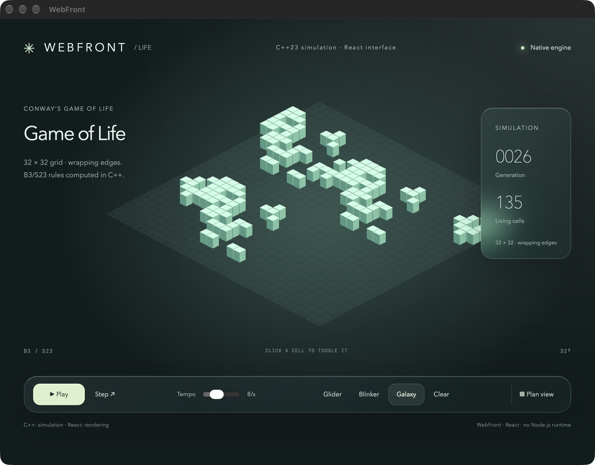

# Browser-powered development

The developer environment downloads its terminal, npm resolver and WebAssembly compiler at
runtime. The application's C++ executable initially contains the bridge and a small bootstrap;
it does not embed React, Babel, xterm or esbuild. Node.js and npm are **not required on the
application developer's machine**. A C++ compiler, CMake and the selected native webview remain
necessary. TypeScript/JSX is transformed in the browser without type checking; `wf check` type-checks the project
with the TypeScript compiler it locks.

This is an experimental, explicit development facility. The downloaded environment runs with
the application's bridge authority and may read/write the selected project. It exposes no shell.
Do not ship developer mode as the distribution configuration.

The 0.4 presentation update prepares developer distribution **0.4.0** with the revised Life text.
It is not published as part of the repository cleanup. Before releasing this branch, publish the
prepared archives using [the package release procedure](../js/developer/tools/PUBLISHING.md).
For local review, provision the generated archive as described below and pass its URL/integrity
to `WebFrontLifeDeveloper`. Existing published versions remain unchanged.

## Minimal C++ application

Enable the platform's native frontend in CMake: `WEBFRONT_EMBED_WKWEBVIEW=ON` on macOS,
`WEBFRONT_EMBED_WEBVIEW2=ON` on Windows, or `WEBFRONT_EMBED_WEBKITGTK=ON` on Linux.
The default `webfront::WebFront` still opens the system browser.

```cpp
#include <webfront/WebFront.hpp>
#include <bitset>

std::bitset<1024> nextLife(const std::bitset<1024>& cells); // Existing C++ simulation.

int main() {
    webfront::NativeApp app{"."}; // Explicit development project directory.
    app.cppFunction("life.step", &nextLife);
    app.bootstrap("developer"); // Uses the version and SHA-512 pinned in WebFront.
    app.show();
}
```

The [versioned distributions](https://ambroise-leclerc.github.io/WebFront/) are published on GitHub Pages.
Version 0.3.0 provides the packed-bitset Life starter and requires the bridge support from #289.
Version 0.3.1 makes `wf install` keep the versions of the installed lock and reject an archive whose integrity differs from it.
Published versions 0.1.0 to 0.3.0 remain immutable; 0.2.0 used string-based Life grids.
On 2026-10-20, the 0.3.0 public download/WASM/React/PI/Life path passed in WKWebView, including
128-byte grid exchange, painting cells across an octet boundary, playback/reset and deterministic
header generation. Both resulting headers were compiled and the applications passed offline
native tests from empty working directories, with developer callbacks absent. Pages returned
HTTP 200, CORS `*` and the pinned archive bytes. These checks supplement offline CTest fixtures.

The default configuration is generated in `include/webfront/system/DeveloperReleaseData.hpp` and targets
`https://ambroise-leclerc.github.io/WebFront/developer/0.4.1/environment.tgz`. This version, published and archived as `developer-v0.4.1`, generates providers that include `<webfront/system/FileSystem.hpp>`. Published 0.4.0 stays immutable but targets the former include layout. The sources are ahead of that pin: `distribution.json` names 0.5.0 (the project manifest), which is not pinned until it has been published and verified (see `js/developer/tools/PUBLISHING.md`). The configuration pins one version and
its SHA-512 rather than resolving a mutable `latest` channel. An explicit
`DeveloperBootstrapOptions{.environment = url, .integrity = trustedHash}` still selects a different
HTTPS/CORS repository or a same-origin test fixture. Users install neither npm nor Node.js.

The environment archive contains pinned Life and PI starter descriptors. `wf create life` downloads and
verifies that separate archive, creates a new `ui` directory and prints the install/preview/embed
commands. Existing directories are never replaced. The trusted environment hash protects both
its own code and the starter descriptor; `provision.json` on the server is not a new trust anchor.
See [publication instructions](../js/developer/tools/PUBLISHING.md) for deployment and release checks.

The bootstrap verifies SHA-512 before unpacking or executing the archive, validates its manifest
and paths, then publishes it under the application's local origin. The cached **archive** is
verified again before reuse, allowing subsequent launches without network access. Failure leaves
a readable status and Retry button. A different pinned hash requires a matching archive; the old
environment is not silently substituted.

## The Game of Life walkthrough

`examples/life/Life.hpp` is a small C++23 B3/S23 simulation on a `std::bitset<1024>`.
Each generation reads the old grid and creates a new one; the 32 × 32 world wraps on both axes.
The core needs no React, server, thread, timer or graphics dependency. `nextLife` is registered directly
with its `const LifeGrid&` argument and bitset result. React stores and exchanges a 128-byte `Uint8Array`,
with cell `i` in bit `i % 8` of byte `i / 8`. The bridge validates the exact unsigned-byte type and length.
`examples/life/LifeConsole.cpp` runs it without WebFront; build and run `WebFrontLifeConsole` to start
with a plain console application.

`examples/life/LifeDeveloper.cpp` adds the native window and downloaded developer bootstrap. Configure
`build-native` with the native frontend option above, then [prepare the local archive](#environment-distribution-and-offline-tests-maintainers) and start with a fresh project directory:

```sh
mkdir -p life-project/.webfront/developer/preview/provision
cp build-developer-environment/*.tgz life-project/.webfront/developer/preview/provision/
integrity=$(node -p "require('./build-developer-environment/provision.json').integrity")
./build-native/examples/WebFrontLifeDeveloper "$PWD/life-project" \
  /webfront/developer/preview/provision/environment.tgz "$integrity"
```

Optional extra arguments `<environment-url> <sha512-integrity>` override the pinned default.
In the downloaded terminal:

```text
wf create life
wf install react@19.3.1 react-dom@19.3.1
wf preview ui/main.tsx
wf embed ui/main.tsx --output generated/LifeUI.hpp
```

The starter contains editable TSX/CSS and an exact-version `webfront.project.json` recipe.
`wf create life another-directory` selects a different new destination; existing directories
are never replaced. React DOM pulls scheduler transitively and checks its React peer.
Edit the local files in your normal editor, then run `wf preview` again. Ctrl+C interrupts
commands, including downloads and builds.

The interface draws an isometric field with raised living cells, soft lighting and translucent
panels. Play/pause, single step, tempo, glider/blinker/galaxy seeds, clear, cell painting and a plan
view make the simulation interactive. Generation and population counters expose its state.
Every step awaits `webFront.cppFunction('life.step')(cells)`; no Life rules run in JavaScript.
Only one generation request can be outstanding. Replacing a pattern or clearing the field stops
animation and discards stale replies. Errors stop playback and appear in the interface.
Canvas rendering has an accessible description; patterns and simulation controls work with the
keyboard. Individual canvas cells are pointer-editable, without keyboard cell navigation.
No fonts, images, 3D library or additional UI framework are downloaded.



`wf embed` builds JS/CSS/resources, creates an HTML entry page, preserves dependency notices and
writes a header-only `webfront::fs::LifeUI` provider using deterministic gzip. The filename stem
determines the C++ provider name. The header is replaced only after all chunks arrive successfully.
The distribution form has no project root or developer callbacks:

```cpp
#include <webfront/WebFront.hpp>
#include "Life.hpp"
#include "generated/LifeUI.hpp"

int main() {
    webfront::NativeAppWithAssets<webfront::fs::LifeUI> app;
    app.cppFunction("life.step", &webfront::demo::nextLife);
    app.show();
}
```

Reconfigure the native build with
`-DWEBFRONT_LIFE_ASSETS=/absolute/path/to/life-project/generated/LifeUI.hpp`, build target
`WebFrontLifeEmbedded` and run it. Recompilation is explicit. The resulting binary needs neither
project sources, downloaded cache nor network.

The PI starter remains available through `wf create pi` for existing projects and regression
coverage. Its sources are maintained under `js/developer/tools/starters/pi/`; the public C++
examples are limited to Hello World and Life. Existing embedded React/Babel providers remain supported.

## Project manifest (`webfront.project.json`)

Available from developer distribution 0.5.0, which is not published yet: the default configuration still pins 0.4.1, whose environment predates the manifest.
A project has one manifest, the equivalent of `package.json`, which every `wf` command reads:

```json
{
  "format": 1,
  "name": "life",
  "version": "0.1.0",
  "dependencies": {"react": "^19.3.1", "react-dom": "^19.3.1"},
  "registry": "https://registry.npmjs.org/",
  "scripts": {},
  "entries": {"main": "ui/main.tsx"},
  "providers": {"LifeUI": {"entry": "main", "output": "generated/LifeUI.hpp"}},
  "test": {"specs": []},
  "permissions": {}
}
```

Only `format`, `name` and `version` are required. Validation is strict: an unknown key, a format
newer than the environment reads, a path leaving the project, a non-HTTPS registry or origin and an
unknown permission are errors printed in the terminal, never silently ignored. `scripts` and `permissions` are
used by `wf run` and `wf exec` (below); `test` is validated here and used by `wf test` (#310). Permissions only frame
the operations of the `context` API of scripts; they are not a sandbox.

- `wf init [name]` writes `webfront.project.json` at the project root, the manifest every `wf` command
  reads; it never replaces an existing one. When a lock already exists (a project installed before
  0.5.0), the manifest takes its roots as dependencies (`^version`, or the range they were installed with).
- `wf install <package>[@range]` resolves, downloads and verifies into the cache, then publishes the
  manifest (the requested range, or `^version` when none was given) and the lock in a single transaction.
- `wf install` without argument installs exactly the locked graph (like `npm ci`) when the lock agrees
  with the manifest, resolves the manifest and creates the lock when there is none, and fails when they
  disagree. `wf install --update` resolves the manifest again.
- `wf preview [entry]` and `wf embed <provider>` use `entries` and `providers`; an explicit path still works.
  `wf embed <provider>` generates the C++ class `webfront::fs::<provider>`; with `--output <Provider.hpp>`,
  the file name must be a C++ class name.
- A requested range is checked like the manifest that records it, before anything is resolved: a range or
  tag the manifest cannot hold is refused instead of written. The manifest is rewritten with the keys it had,
  plus the new dependencies.

The manifest holds the intent (roots and ranges), the lock the exact resolution. The lock records a
digest of the manifest's `dependencies` (`manifestDigest`). The project is **consistent** when they
match, **unlocked** without a lock (no installed graph) and **desynchronized** when the dependencies
changed since the lock was written; every command reports that state and none resolves implicitly.
A lock written before 0.5.0 has no digest: it is used as consistent when its roots satisfy the
dependencies (after `wf init`, they do), and `wf install` records the digest without resolving anything.

Both files are published by one all-or-nothing transaction (`developer::Store::commitGroup`): the
staged files are moved under `.webfront/developer/journal/`, a journal naming them is written and
synchronized to disk (the commit point), then each file replaces its target. Opening the project
completes a journal that reached its commit point and abandons the others, so a crash never leaves
a manifest and a lock that belong to different installations. A failure before the commit point returns
the staged files to their transactions. A committed publication whose replacement fails (a target turned
into a directory, a file locked by another program) is reported as committed but not applied yet; its
journal is kept, the project still opens, and every later command first completes it, failing with the
cause until it can. The publication carries a precondition,
the fingerprint of both files as read when the command began: if another browser or command changed
them meanwhile, it is refused with "The project changed since it was read; run the command again" and
nothing is lost. Recovery and group publications also hold an advisory lock on `.webfront/developer/journal/.lock`, so
several processes sharing a project (or several stores of one process) are serialized rather than abandoning one
another's publication; other project files stay unprotected against concurrent local modification. `wf restore` fills the cache from the lock without ever writing them.

## Restoring the cache and choosing the registry (`wf restore`)

The cache under `.webfront/developer/packages/` is not committed. On a new machine, after a clone, or
when it is damaged, `wf restore` rebuilds it from the lock alone:

- each locked package is downloaded at its exact locked version (no range is resolved again) and checked
  against the lock's SHA-512 integrity; packages already valid in the cache are not downloaded again, so the
  command is idempotent;
- every package is published on its own: Ctrl+C or an error (changed archive, package absent from the
  registry) keeps the packages already restored and never writes the manifest or the lock; run the command again;
- `wf restore --offline` contacts no registry at all: it checks the cache against the lock and fails with the
  list of missing or corrupted packages, without downloading anything.

Each cached package directory `<key>/` is followed by a record `<key>.json` naming the archive's integrity and the
SHA-256 of every file; the record is written last, so an interrupted copy is *missing*, and a file that differs
from its record, or exceeds the bound below, is *corrupted*. The 256 MiB bound applies to the whole unpacked graph,
packages already in the cache included, and is checked before each package is published, so resuming a restore
cannot exceed it. `wf install` with a consistent lock performs the same restoration.

The registry used by `wf install` and `wf restore` is, in order of precedence:

1. the application's `DeveloperBootstrapOptions::registry` (the distributor's trusted channel; a test driver
   uses it to impose its local registry),
2. the manifest's `registry`,
3. `https://registry.npmjs.org/`.

Both commands print the registry in use and where it comes from, for example
`Registry: /mirror/ (application option)`. A registry must use HTTPS or be a path on the application's own
origin, like the environment archive (a path starting with `//` or containing a backslash, which browsers read as
another host, is refused); tarballs must use HTTPS or the registry's origin. The lock's `registry`
field records where the graph was resolved and is not used to restore it, so a mirror can serve a lock resolved
from the public registry.

Offline provisioning, extending ADR-013's explicit local provisioning: serve a directory of packuments (`<name>`)
and tarballs from the application (`fs::NativeDebugFS` or an application provider) and pass its path as
`registry`, then run `wf restore`; or copy `.webfront/developer/packages/` from another machine and check it with
`wf restore --offline`. The environment archive is provisioned the same way (see below).

## Scripts (`wf run`, `wf exec`)

WebFront scripts replace npm scripts and `npx` for producing a project's resources, without Node.js:

```json
{
  "scripts": {"icons": "tools/icons.ts --size 64", "build": "wf embed LifeUI"},
  "permissions": {"files": ["assets"], "publish": ["generated"], "fetch": ["https://api.example.org"]}
}
```

- `wf run [--timeout <seconds>] <script> [args...]` runs a script of the manifest. A script whose first word is `wf`
  runs that wf command (up to four nested levels); otherwise its first word is the project path of a JS or TS module
  and the other words, then the command's arguments, are its `context.args`. No shell is involved.
- `wf exec [--timeout <seconds>] <package>[:<entry>] [args...]` runs an executable WebFront entry of an installed
  package: the field `webfront.bin` of its `package.json`, a path or an object naming paths. npm's `bin` is never run:
  a package with only a `bin` (a Node.js program) is refused, as is a browser package without `webfront.bin`.

The module is bundled by esbuild-wasm with its locked dependencies (JSX with the automatic runtime, as for previews)
and runs in a dedicated Worker; only the package files it imports are read from the cache. It exports
`default async function (context)`, where `context` offers:

| Member | Behavior |
| --- | --- |
| `args` | The arguments, as an array of strings. |
| `signal` | An `AbortSignal` aborted by Ctrl+C and by the time limit. |
| `console` | `log`/`info`/`debug` and `warn`/`error`, streamed to the terminal; the Worker's global `console` too. |
| `project.read(path)`, `readText(path)` | A project file as bytes or text, under `permissions.files` or `publish`. |
| `project.list(path = '')` | The names in a project directory (directories end with `/`). A readable directory is listed whole; the root and the directories leading to granted paths list only the entries leading to them. |
| `project.write(path, data)` | Publishes a string or `Uint8Array` with `developer::Store`, under `permissions.publish`. |
| `packages.resolve(name)` | `{name, version, integrity}` of a locked package, or `null`. |
| `fetch(input, init)` | `fetch` of a URL or a `Request` to an origin listed in `permissions.fetch`; a refusal rejects. Redirects are not followed, since their target could be any origin: the promise rejects and the script requests the final URL. |
| `exit(code)` | Ends the run with an exit code from 0 to 255; it throws, so the statements after it do not run, and nothing the script does afterwards reaches the page. |

A `context` operation outside the permissions rejects with an explicit error. The manifest, the lock and
`.webfront/` are never written by a script, whatever the permissions. **The permissions frame only the `context`
API**: the Worker keeps its own capabilities (global `fetch`, `importScripts`, WebSocket...), and nothing here is a
security boundary. Node.js modules (`fs`, `child_process`, `node:*`...) are refused while the script is loaded,
unless a locked package of that name is a dependency of the importer; `process` does not exist and no polyfill is
provided.

Ctrl+C first aborts `context.signal`; a script still running two seconds later (the grace period) is terminated with
`worker.terminate()`, which also stops a loop that never returns to the event loop. The time limit (`--timeout`,
600 seconds by default, from 1 to 3600) applies the same sequence; it also bounds the scripts that the script runs
through `wf` commands, whatever their own limit. The terminal stays usable. Each write is a transaction of its own:
at a stop, one still staging is aborted and leaves the file unchanged, and one whose commit was already sent
completes atomically; the terminal lists the publications applied and abandoned. When a script ends by itself, the
writes it did not await complete first; if one of them fails, the run ends with code 1 and names it. A script that
returns ends with code 0, a thrown error with 1, `exit(code)` with that code, Ctrl+C with 130 and the time limit with
124; a non-zero code is an error carrying `exitCode`.

## Type checking (`wf check`)

Previews and providers are built by esbuild-wasm, which removes the types without checking them. `wf check
[--timeout <seconds>]` runs the TypeScript compiler of the project's lock on the project, in the browser:

```sh
wf install typescript@6
wf check
```

- **Supported versions**: `typescript` 5.x and 6.x (`>=5.0.0 <7.0.0`), whose `lib/typescript.js` provides the
  compiler API; 5.9.3 and 6.0.3 are tested. An older version, or TypeScript 7 (a native program without that API), is
  refused with an explicit message. The version is the one the lock records, never a copy shipped by WebFront.
- **Options**: the project's `tsconfig.json` if it exists (comments, `extends` of project or package files,
  `include`/`exclude`/`files`, `compilerOptions`). Otherwise the TS/TSX entries of `webfront.project.json` are the root
  files, with `target` ES2022, `module` ESNext, `moduleResolution` Bundler, `jsx` react-jsx, `lib` ES2022/DOM/
  DOM.Iterable, `strict`, `isolatedModules` and `skipLibCheck`. `noEmit` is always added (and `emitDeclarationOnly`
  removed), the other options keep their meaning; nothing is written, not even build information. Project references
  are not followed.
- **Two phases**: the check runs in a dedicated Worker. It first loads, asynchronously, an in-memory snapshot: the
  `lib.*.d.ts` of the locked `typescript`, the declaration files and `package.json` of every locked package, then the
  `.ts`/`.tsx`/`.mts`/`.cts` files (with `.js` family files under `allowJs`, `.json` under `resolveJsonModule`) and
  `package.json` files of the directories that `tsconfig.json` includes, or of the entries' directories, recursively,
  and the `package.json` files above them up to the project root, which give their module format.
  `node_modules`, `.webfront` and `.git` are never listed. TypeScript then compiles synchronously over that snapshot:
  a file absent from it does not exist, including a project file imported from outside those directories.
- **Type resolution** follows TypeScript, not esbuild: `types`/`typings`, the `types` condition of `exports`,
  `@types/*` and the `moduleResolution` of `tsconfig.json`. Only the locked graph is visible, without flattening: the
  project sees its roots, and each package its own dependencies.
- **Diagnostics** print as `file(line,column): error TScode: message`, with project-relative paths, or
  `<package>@<version>/<path>` inside a package, then a summary. Any error ends the check with code 1.
- **Bounds**: the snapshot holds at most 10,000 files and 64 MiB, and listing stops at 50,000 directory entries. A
  snapshot that reaches its bounds still compiles but reports the files it left out and fails; a listing past its
  bound fails at once. TypeScript itself (about 9 MiB) is read from the cache and is not counted. The Worker's memory
  is the browser's; it is not limited further.
- **Time**: `--timeout` (600 seconds by default, from 1 to 3600) and Ctrl+C stop the check like `wf run`: a check
  still loading its snapshot stops at its next read, and one compiling, which never returns to its event loop, is
  terminated with `worker.terminate()` after the two-second grace period. The exit code is 130 (Ctrl+C) or 124 (time
  limit), and the terminal stays usable.

## The terminal and the application's commands

The terminal of the environment (developer distribution 0.5.0, #308) is the only WebFront terminal; it is served
from the environment archive with xterm.js, never from a C++ header. It runs `wf` commands, the application's C++
commands and its own: `help`, `clear` (screen and scrollback), `history` (`history -c` clears it) and
`exit [code]`, which ends the session and closes the window; when the browser keeps a window that a script did not
open, Enter starts a new session. No system shell is exposed.

- **Editing:** left/right, Home/End (Ctrl+A/Ctrl+E), Backspace/Delete, Ctrl+U/Ctrl+K, Ctrl+L, up/down through the
  history. A line wider than the terminal wraps over several rows and is redrawn in place; a line taller than the
  terminal is drawn a screen of rows at a time around the cursor, since rows that left the screen cannot be rewritten. The editor moves over
  grapheme clusters: CJK characters and emoji (ZWJ sequences, flags, skin tones, presentation selector) take two
  cells, combining marks none. The same widths are registered in xterm.js, so both always agree.
- **History:** kept per project in `.webfront/developer/history.json` (500 lines), restored by the next terminal. Each
  line is added to the file as it is, with a conditional publication tried again on conflict, so terminals of several
  pages on the same project keep each other's lines. A history file that cannot be read is never replaced.
- **Typing ahead and paste:** keys typed or pasted while a command runs are applied after it, line by line; a last
  line without a line break waits on the prompt. Ctrl+C drops the keys still waiting.
- **Completion (Tab):** command names, `wf` subcommands, the manifest's scripts after `wf run`, its entries and
  providers after `wf preview` and `wf embed`, and project paths, also when the word is escaped (`my\ dir/`) or
  quoted (`"my dir/`); the completion is written the same way and closes the quote. Several candidates are completed
  to their common prefix, or listed.
- **Exit codes:** a failed command prints `Error: <message>`, with `(exit code N)` when N is not 1. Ctrl+C gives 130.
- **Output streams** while a command runs, for `wf` and C++ commands alike, without a size limit: C++ output is
  sent in pieces below the 65,535-byte limit of bridge strings.

An application adds its own commands with `webfront::Commands` (`<webfront/Commands.hpp>`), which replaces
`terminal::Shell` of the standalone terminal component. A command is a coroutine:

```cpp
#include <webfront/Commands.hpp>

webfront::NativeApp app{projectDirectory};
webfront::Commands commands{app};
commands.add("count", "Count to N, once a second", [](webfront::Commands<webfront::NativeApp>::Context context) -> webfront::Task {
    using namespace std::chrono_literals;
    for (int i = 1; i <= std::stoi(context.args().at(0)); ++i) {
        co_await context.print(std::to_string(i) + "\n");
        co_await context.ui().resumeAfter(1s);
    }
});
app.bootstrap("developer");
app.show();
```

The terminal discovers the commands through the bridge (`webfront.commands.list`) and runs each one in the session
of its browser with `webfront.commands.start`. In C++, the command is spawned like `ui.spawn` on the server thread:

- `context.write(text)` streams output with fire-and-forget calls; `co_await context.print(text)` sends it piece by
  piece and, after each piece, suspends the command while more than 32 frames wait for a browser that reads slower
  (`ui.writesAtMost`, woken by the write that drains the queue); each wait is a point where Ctrl+C stops it.
  `context.args()` holds the words after the command name, split like a shell line; `context.exit(code)` sets the
  exit code. A command that returns once asked to stop reports 130, whatever it returned.
- Ctrl+C sends `webfront.commands.cancel`: the command's stop token is requested, which the senders it awaits
  observe (`ui.resumeAfter`, `ui.jsFunctionSender`, ...); loops check `context.stopRequested()`. The terminal does
  not wait for the command to end: the prompt returns at once and the next command runs, while the first one
  unwinds. Its late output and exit report are ignored.
- The browser's disconnection stops its commands, and the application's shutdown drains them with its other tasks.
- An exception thrown by a command is printed as an error, with exit code 1.
- Each connected browser has its own session: a command in one browser neither delays nor is stopped by another.
- A command must not block the server thread, which serves every browser: a handler that does not return
  `webfront::Task` does not compile. Long computations belong on another thread.

A second `webfront::Commands` on the same application throws `std::logic_error`. The names `wf`, `clear`, `exit`,
`help` and `history` are reserved. `context.write` has no flow control: a command
writing large output with it, faster than the browser reads, grows the connection's write queue; use
`context.print` for such output.

## Dependencies, storage and limitations

- `wf install` accepts exact versions, registry tags and semver ranges, resolves ordinary
  transitive dependencies, and retains separate nodes for different versions. Required peers must
  be satisfied by compatible explicitly installed roots or direct dependencies; conflicts fail.
- Package installation scripts, native add-ons and Node.js APIs are unsupported. Packages must be
  usable in a browser. Optional dependencies are not installed in this first version; imports of
  missing dependencies fail during the build. This is not a replacement for the complete npm CLI.
- Browser/production exports, ESM, CommonJS, TS/TSX, JSX, CSS and imported resource files are supported.
  Private package exports, network imports and unavailable Node built-ins fail. Package-specific
  build pipelines and automatic polyfills are not supplied.
- `webfront-packages.lock.json` records exact package versions, dependency edges, source integrities,
  requested roots and the digest of the manifest dependencies it resolved. Commit it and the source TSX/CSS; the generated provider can also be committed.
  Preview/embed consume the locked local files without resolving versions again.
- Unpacked packages are cached by name, version and integrity under `.webfront/developer/packages/`,
  each with a record of its files' digests. A failed install can leave unused cached packages, but the lock
  file remains unchanged. A lock naming more than 512 packages is refused. The tools
  installed by the existing `ToolManager` keep their separate store and `webfront-tools.lock.json`.
- Published environment/preview resources are served under `/webfront/developer/`. The protected
  `/WebFront.js` remains the library's version. Sources, staging and cached archives are not HTTP
  routes. Project reads and publications reject traversal and escaping symlinks. This does not
  isolate downloaded tools or defend against concurrent modifications by another local process.
- Transfers use sequential 256 KiB chunks. Downloads are bounded to 64 MiB compressed; unpacking,
  dependency source graphs and individual publication transactions to 256 MiB, with 512 packages
  and eight active publications at most. A publication untouched for ten minutes (a reloaded or disconnected browser) is
  abandoned, and staging left by a crashed process is removed after an hour. Browser builds time out after 120 seconds.
- Installing another package keeps every locked version that still satisfies a requested range and fails if its
  archive no longer matches the recorded integrity; only new ranges are resolved. Review the resulting lock
  changes. `wf restore` rebuilds the cache of a lock on a fresh machine (see above).

## Environment distribution and offline tests (maintainers)

These commands require Node/npm **only for environment maintainers**. They prepare a tarball that
application developers can download. No command publishes anything to a registry automatically.

```sh
npm ci --prefix js/developer/vendor --ignore-scripts
node js/developer/tools/build.mjs build-developer-environment --refresh-bootstrap
node js/developer/tools/fixtures.mjs build-developer-environment
```

`build.mjs` bundles the environment and compiler, includes esbuild.wasm, xterm styles and licenses,
and writes deterministic `environment.tgz`, `life-starter.tgz`, `pi-starter.tgz`, `provision.json` and
`DeveloperReleaseData.hpp`. The version and public base URL are in `js/developer/tools/distribution.json`. Dependencies are
pinned in `js/developer/vendor/package-lock.json`. `--refresh-bootstrap` additionally refreshes the two
checked-in JS bundles, their input checksums and the embedded bootstrap headers. Without that flag,
it writes only to the output directory. The archives have the package identifiers `@webfront/developer-environment`,
`@webfront/life-starter` and `@webfront/pi-starter`. They are distributed as static GitHub Pages downloads; no npm publication or
scope ownership is required. Node/npm is only used by maintainers to build them.

To try the local archive without an HTTPS server, after building the packages above:

```sh
mkdir -p life-project/.webfront/developer/preview/provision
cp build-developer-environment/*.tgz life-project/.webfront/developer/preview/provision/
integrity=$(node -p "require('./build-developer-environment/provision.json').integrity")
./build-native/examples/WebFrontLifeDeveloper "$PWD/life-project" \
  /webfront/developer/preview/provision/environment.tgz "$integrity"
```

The preview command later replaces that directory, but the verified archive is already cached
independently for subsequent launches. These are maintainer provisioning commands; the application's
terminal still installs and builds browser dependencies without a local Node/npm installation.

Fixture provisioning writes the tests' local npm registry (`js/developer/tools/registry-fixture.mjs`):
packuments and tarballs packed reproducibly from the pinned `jasmine-core`, React, React DOM and scheduler of the
maintainer's npm installation, plus synthetic packages for the edge cases (a newer version under a locked range,
an archive that no longer matches its integrity). The test application serves it from its own origin and imposes
it through the `registry` option. The CEF-off `DeveloperJavaScript` case generates the synthetic part in memory to
test `wf restore`. No CTest case downloads from the public registry. Generating the fixture and the packages'
logic use only browser APIs; reading `node_modules` and writing files (`registry-fixture-node.mjs`) are the
Node-only part, so that `wf` can take the fixture over (#318).

```sh
cmake -S . -B build-native -DCMAKE_BUILD_TYPE=Release \
  -DWEBFRONT_EMBED_CEF=OFF -DWEBFRONT_EMBED_WKWEBVIEW=ON \
  -DWEBFRONT_WEBTEST_FRONTEND=WKWebView -DENABLE_TESTING=ON \
  -DWEBFRONT_DEVELOPER_FIXTURES="$PWD/build-developer-environment"
cmake --build build-native --parallel
ctest --test-dir build-native -R 'Developer|LifeEmbedded' --output-on-failure
```

The GitHub CI prepares these fixtures for both WKWebView and CEF jobs. The initial 0.2.0 Life version passed
WKWebView and all 14 Linux CEF/Xvfb cases with both GCC and Clang in
[run 39421265580](https://github.com/ambroise-leclerc/WebFront/actions/runs/39421265580).
The packed 0.3.0 version passes WKWebView and all 14 GCC CEF/Xvfb cases in
[run 39490581423](https://github.com/ambroise-leclerc/WebFront/actions/runs/39490581423).
For Linux, select CEF and Xvfb instead; the same developer tests use the selected test frontend.
`DeveloperBrowserIntegration` exercises the real WASM compiler, local registry, PI and Life previews, C++ generation/animation and
repeatable header generation. Its CTest fixtures then build that **browser-generated** header and run
`DeveloperEmbeddedIntegration` and `LifeEmbeddedIntegration` from empty working directories
with no developer callbacks.
The standard CEF-off suite also checks project transactions, path rejection, PI, Life rules and boundaries, MIME types,
bootstrap freshness, package resolution, gzip generation, interruption and offline cache reuse.
