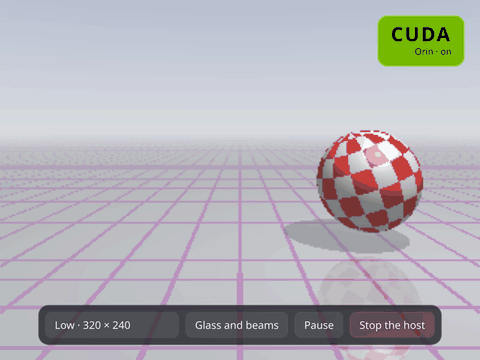

# The host-loop example: a ray-traced Boing Ball

[Back to host integration](HOST_INTEGRATION.md)

`examples/host-loop/` (`WebFrontHostLoop`) is an application that keeps its own loop and gets a WebFront interface. Its
loop ray-traces a red and white checkered ball that bounces and rolls above a gridded floor, with a moving light, a
sharp shadow and a reflection on the floor. On request the ball turns into tinted glass that reflects and refracts, and
sends a coloured beam through each of its red squares: the beams show in a haze and light the floor. Every pixel is
computed in C++, on the CPU or with CUDA; the page only draws a typed array of pixels on a canvas. No WebGL, no
JavaScript renderer: the page is a string in the executable and loads no local file or remote resource. WebFront
serves it over loopback HTTP and carries calls over WebSocket.



It is an example of integration, not a renderer: one sphere, one plane, one point light, a bounded number of bounces.
Soft shadows and caustics are out of its scope, and the beams are neither reflected nor refracted by the ball.

**Two workloads.** The opaque ball is cheap to compute and its image is made of flat colours. The glass ball is the
heavy one: each ray also takes 32 samples of the beams along its path, about thirty times the work. It is there to
show what CUDA brings: the opaque ball is computed fast enough by both engines for the display to be the limit.

## Build and run

The example is built with the other examples, with no option:

```bash
cmake -S . -B build -DCMAKE_BUILD_TYPE=Release
cmake --build build --target WebFrontHostLoop --parallel
build/examples/WebFrontHostLoop
```

| Option | Effect |
| --- | --- |
| `--engine cpu\|cuda` | The renderer at start (default `cpu`). `cuda` where it is unavailable is an error, not a silent CPU run. |
| `--quality 0-3` | 0: 320 x 240; 1: 640 x 480; 2: 640 x 480 with 4 rays per pixel; 3: 960 x 720 with 4 rays per pixel (default). |
| `--glass` | Start with the glass ball and its beams. |
| `--browser` | Open the system browser even when the native window is built. |
| `--stats` | Print the timings of an image every second. |
| `--capture-frames <1-600>` | With `--capture`, save numbered PNGs (`file-0000.png`, …) with a fixed 25 fps simulation clock. Each step waits for drawing and capture before advancing; rendering or PNG overhead never skips scene time. Default: one PNG at the exact `--capture` path. Failed frames return nonzero; earlier files remain. |
| `--capture-demo` | With `--capture`, capture one continuous sequence, switch to glass after two thirds through the UI's settings handler, hide the statistics panel and use a 640 × 480 CSS-pixel window. Default: 300 frames (12 seconds at 25 fps); an explicit count must be a multiple of three. Combine with `--quality 0` for a 320 × 240 scene. |
| `--capture <file.png>` | Write a PNG of what the native window shows after six seconds (`frontend::capturePng`), then stop the host. Requires a native frontend; incompatible with `--browser` and `--benchmark`. An unsuccessful capture or write, or closing before capture, returns a nonzero status. |
| `--benchmark` | Time both renderers without any interface, and exit. |

The image fills the window and the controls float over it: a large **CUDA** switch, lit in green while CUDA computes
and dark while the CPU does, the quality, "Glass and beams", "Pause", and a button that stops the host. A panel shows
the engine really used, the size and rays of the image, how it was sent, and five times and a rate measured where they
happen. The switch is the example's own drawing, not NVIDIA's logo.

**CUDA is optional.** `WEBFRONT_HOST_LOOP_CUDA` is `AUTO` by default: the CUDA renderer is built when CMake finds a
working CUDA compiler, and the example is complete without one. `ON` makes a missing toolkit a configuration error and
`OFF` never looks for one. nvcc does not compile C++23 and bounds the host compiler it accepts: the renderer is one
`.cu` unit compiled at C++17, and `CMAKE_CUDA_HOST_COMPILER` names another host compiler when nvcc refuses the default
one. At run time the engine is offered only when a device answers.

For a local GPU build, set `CMAKE_CUDA_ARCHITECTURES` to the device's compute capability when the compiler's default
does not include it (for example, `-DCMAKE_CUDA_ARCHITECTURES=89` for an RTX 4060 Ti). This embeds native code for that
device. Otherwise execution can require the driver's PTX compiler, which must understand the toolkit's PTX version;
an older driver may report an unsupported toolchain even when the toolkit builds successfully. Distribution builds
should select architectures appropriate for their target devices.

**The window.** With the platform's native engine in the build (WebKitGTK on Linux, autodetected), the example opens
a native window; otherwise, or with `--browser`, it opens the system browser. On a Jetson Orin (L4T R39.2.1,
Ubuntu 24.04) the native window opens with no change to the system: no AppArmor profile, no sysctl, no package.

> This is a **development build** of WebFront: it disables the sandbox of WebKitGTK's web process and says so when it
> starts. That is acceptable here because the page is the application's own, embedded, and loads nothing remote. It is
> not a deployment: a packaged application selects the distribution mode, in which the sandbox is required; see
> [development and distribution](WEBKITGTK.md#development-and-distribution). The example neither selects that mode nor
> changes any system policy.

### Reproduce the README animation

The GIF is one continuous CUDA sequence captured on the Orin Nano: 200 checkered-ball frames followed by 100
illuminated-glass frames. The simulation advances by exactly 40 ms per captured image, independently of rendering
and PNG encoding time. Playback at 25 fps preserves the scene's normal speed: eight seconds, then four. The same
position, bounce, spin and light clock continue across the material switch, as when using the interface's checkbox.
The GIF is resized to 480 × 360. The statistics panel is hidden; the CUDA indicator and controls remain part of the captured application. This offline
capture is an illustration, not a throughput measurement. From the repository root with a native-window CUDA build:

```sh
mkdir -p build/boing-capture
build/examples/WebFrontHostLoop --engine cuda --quality 0 --capture build/boing-capture/frame.png --capture-demo
```

Assemble the PNGs with Python and Pillow (an image-authoring tool, not an application dependency):

```sh
python3 docs/images/render-boing.py build/boing-capture
```

The script keeps the captured content at 480 × 360, adding a title bar, window controls and border
for a 482 × 394 GIF with transparent outer corners and no surrounding margin. This illustrative native-window framing is added during assembly because `capturePng`
returns only the web view's content, without operating-system decorations. It does not change the simulation
clock, frame count or continuous material transition.

## How it is put together

| File | Role |
| --- | --- |
| `BoingScene.hpp` | The colour of one pixel as a function of the scene of a frame, and the scene as a function of time. Plain C++17, compiled by both renderers. |
| `BoingCuda.cu`, `BoingCuda.hpp` | The CUDA kernel (one thread per pixel calls the same `pixel()`), behind three plain functions. Includes no WebFront header. |
| `BoingHost.hpp` | The host: settings, clock, CPU renderer, run-length packing, and the loop. Knows nothing of WebFront. |
| `HostLoopUI.hpp` | What WebFront adds: four callbacks and the page. |
| `HostLoop.cpp` | `main`: the two ways to open the interface around the same loop. |
| `HostLoopCapture.hpp` | Validation of capture mode and saving the PNG, including write and close errors. |

**The loop belongs to the host.** Each iteration reads the words other threads left (settings, requests, stop),
advances the scene by the time elapsed unless paused, and computes an image only if a browser waits for one. The scene
goes on whether or not anyone watches. With the system browser, `app.start()` returns and the loop keeps the main
thread ([first path](HOST_INTEGRATION.md#1-return-to-the-host-start)). A native window owns the main thread, so the
same loop runs on a thread of the host, which closes the window when the loop ends and is stopped and joined when the
user closes the window first ([third path](HOST_INTEGRATION.md#3-the-interface-owns-the-main-thread-show-and-requestclose)).

**Callbacks compute nothing.** They run on WebFront's server thread and return at once: `host.settings` validates and
stores, `host.nextFrame` records who asks, `host.stop` raises a flag. The interface stays responsive however long an
image takes. A setting the host cannot honour (an unknown quality, CUDA without a device) rejects the Promise and
changes nothing; the page shows the reason.

**At most one image is on its way to a browser.** The page asks for the next image from the animation frame in which
it has drawn the previous one. The loop answers each request with exactly one image, the first it computes afterwards,
sent from its own thread with `ui.jsFunction`. Nothing is queued: a slow page makes the loop compute fewer images, a
hidden page none, and a disconnected browser's image is dropped. When the loop ends it drops the pending requests, so
nothing still refers to a browser when the application is destroyed.

**The opaque image travels as runs, the glass one as pixels.** Carrying the pixels is what costs most once CUDA
computes them (see the measurements). The opaque ball stands before flat colours, so the host packs its image by run
length: each run of equal pixels becomes its length and the pixel, and the page expands them. The beams of the glass
ball leave hardly two neighbours alike: its runs would take more room than its pixels (144 % at 640 x 480 with 4 rays),
so that image is sent as it is. The choice follows the ball; it is not a setting.

### The bridge

| Call | Direction | Meaning |
| --- | --- | --- |
| `host.info()` → `[device, threads]` | page → C++ | The CUDA device (`""` when there is none) and the number of CPU threads. |
| `host.settings(engine, paused, glass, quality)` → `revision` | page → C++ | `engine` 0 (CPU) or 1 (CUDA), `quality` 0 to 3. Rejects what the host cannot honour. Images computed with these settings carry at least this revision. |
| `host.nextFrame(framesPerSecond, drawMs, bridgeMs)` | page → C++ | The calling browser has shown its image, measured this, and wants the next one. |
| `host.stop()` | page → C++ | Ends the host's loop. |
| `hostLoop.onFrame(data, [sequence, width, height, raysPerPixel, revision, packed], [engine, paused, glass, quality], [computeMs, copyMs, packMs])` | C++ → page | `data` is a `Uint32Array`: the `width * height` pixels, whose bytes are R, G, B, A (the page wraps the buffer in an `ImageData`), or, when `packed`, their runs (a length, then the pixel). |

Every image carries the settings it was computed with, so several browsers show the same state and a refused choice
returns to the real one. The page lets an image set its controls only if its revision is at least the one its last
`host.settings` call returned: an image computed just before a choice does not undo that choice on screen.

## What is measured

| Value | Measured by | What it covers |
| --- | --- | --- |
| compute | the host | The whole computation of the image. For CUDA it ends when the device has finished (`cudaDeviceSynchronize`), not when the kernel is launched. |
| copy | the host | Bringing the pixels back from device memory. Zero on the CPU, which computes in place. |
| pack | the host | The run-length encoding of the opaque image. Zero for the glass one. |
| bridge | the page | The time between its request and the image, less compute, copy and pack: the request, the wait for the loop, the encoding, the WebSocket, and the decoding of the typed array in JavaScript. |
| draw | the page | Expanding the runs, if any, and `putImageData` on the canvas. |
| displayed | the page | The images it really drew in animation frames during the last second: the rate seen, not the rate computed. |

The clock of a WebKitGTK page has a resolution of 1 ms, so `draw` below that reads 0 or 1.

When the display is what limits the rate, the page is busy painting when the next image arrives, and that wait is
counted in `bridge`: read `bridge` as "everything between the host and the canvas", not as the cost of the WebSocket alone.

## Measurements on a Jetson Orin Nano

Conditions, 2026-11-16: Jetson Orin Nano Super developer kit (8 GB), L4T R39.2.1, Ubuntu 24.04, power mode 25 W;
CUDA 13.2.86 with GCC 13.3.0 as host compiler, WebFront built in Release (`-O3`) by GCC 13.3.0; the CPU renderer on the
6 cores (6 threads); native WebKitGTK 2.52.6 window on X11, WebFront in **development mode**. The board and its
qualification are described in [the Jetson guide](JETSON.md).

**The computation alone** (`WebFrontHostLoop --benchmark`: mean of 60 images after 3 unmeasured ones, no interface):

| Image | Ball | CPU compute | CUDA compute | CUDA copy |
| --- | --- | ---: | ---: | ---: |
| 320 x 240, 1 ray | opaque | 2.4 ms | 0.2 ms | 0.1 ms |
| 320 x 240, 1 ray | glass | 45.8 ms | 1.2 ms | 0.1 ms |
| 640 x 480, 1 ray | opaque | 8.6 ms | 0.6 ms | 0.4 ms |
| 640 x 480, 1 ray | glass | 175 ms | 4.8 ms | 0.3 ms |
| 640 x 480, 4 rays | opaque | 24.9 ms | 0.8 ms | 0.3 ms |
| 640 x 480, 4 rays | glass | 675 ms | 18.8 ms | 0.4 ms |
| 960 x 720, 4 rays | opaque | 53.9 ms | 2.0 ms | 0.7 ms |
| 960 x 720, 4 rays | glass | 1505 ms | 41.2 ms | 0.7 ms |

**What is displayed** (`WebFrontHostLoop --stats` at the default quality, 960 x 720 with 4 rays per pixel, in the native
window at its default size, 800 x 600; typical values after 15 s):

| Ball, transport | Engine | compute | copy | pack | bridge | draw | displayed |
| --- | --- | ---: | ---: | ---: | ---: | ---: | ---: |
| opaque, runs | CPU | 60 to 66 ms | 0 | 1.3 ms | 5 to 7 ms | 4 to 6 ms | 12 images/s |
| opaque, runs | CUDA | 2.5 to 5 ms | 0.8 ms | 1.4 ms | 32 to 36 ms | 5 to 7 ms | 20 images/s |
| glass, pixels | CPU | 1.5 s | 0 | 0 | 35 to 37 ms | 1 to 2 ms | fewer than 1 image/s |
| glass, pixels | CUDA | 39 to 59 ms | 0.8 ms | 0 | 23 to 32 ms | 1 ms | 12 images/s |

How to read them:

- **The window itself displays about 20 images per second.** A page that only repaints a canvas at every animation
  frame, with no bridge and no computation, shows 18 to 23 images per second in this window, at 320 x 240 as at
  960 x 720, although its animation frames alone run at 62 per second. WebKitGTK's rendering on this board is the limit
  ([#528](https://github.com/ambroise-leclerc/WebFront/issues/528)); it is not a limit of CUDA or of the bridge.
- **With the opaque ball, CUDA reaches that limit and the CPU does not**: 20 images per second against 12. The
  computation is 20 to 30 times faster, the display 1.7 times: beyond the limit of the window a faster computation
  shows nothing.
- **What the page paints counts as much as what the host computes.** In a 1200 x 900 window the same page displays
  12 images per second with either engine, and drop shadows under the floating panels brought every configuration down
  to 7 or 8: the panels have none, and the window opens at 800 x 600. Enlarging it lowers the rate on this board.
- **With the glass ball the engines part**: 12 images per second against fewer than one. This is the workload in which
  the computation, not the display, decides.
- **Carrying the pixels costs more than computing them with CUDA.** One raw 960 x 720 image takes about 29 ms through
  the bridge; as runs, about 12 ms including their expansion in the page (measured apart, on the opaque image). The
  decoding in JavaScript is about 3 ms of the raw figure; most of the rest is spent sending the 2.7 MB.

These first figures describe this board, this development build and this window. The follow-up below covers the
system browser and distribution; another power mode remains unmeasured.

### System browser and distribution follow-up

Measured on the same board on 2026-11-16, still at 25 W, Release (`-O3`), GCC 13.3 and CUDA 13.2.86, with six CPU
threads. The scene is 960 x 720 with four rays per pixel. Both interfaces have an 800 x 600 CSS-pixel content area
and a device scale factor of 2, on the real X11 desktop. Builds were suspended during measurements. Each configuration
warms up for 15 s, followed by 20 s of observation; the times below are medians, not guarantees or an isolated measure
of the sandbox's cost.

**System browser:** `WebFrontHostLoop --browser --stats`, using the system's default browser, Brave 157.1.99.57
(Chromium 157.0.8103.79), with a separate temporary profile and a visible application window. The content dimensions
were checked through DevTools. Brave reports NVIDIA Tegra Orin through ANGLE, with GPU compositing and Canvas 2D
enabled. DevTools reads the page's existing statistics once a second; the display rate uses the difference in image
sequence numbers over the observation interval, including the CPU glass case where the page's integer one-second
counter cannot express a rate below one. The page's Stop button ended the host with exit status 0.

| Ball, transport | Engine | compute | copy | pack | bridge | draw | displayed |
| --- | --- | ---: | ---: | ---: | ---: | ---: | ---: |
| opaque, runs | CPU | 59.1 ms | 0 | 1.4 ms | 3.8 ms | 9.1 ms | 10.4 images/s |
| opaque, runs | CUDA | 1.2 ms | 0.7 ms | 1.5 ms | 4.3 ms | 9.6 ms | 30.0 images/s |
| glass, pixels | CPU | 1578 ms | 0 | 0 | 15.9 ms | 0.7 ms | 0.63 images/s |
| glass, pixels | CUDA | 51.5 ms | 0.8 ms | 0 | 16.6 ms | 0.6 ms | 11.0 images/s |

**Distribution:** a separate build with `WEBFRONT_DISTRIBUTION=ON` and WebKitGTK 2.52.6. The executable was installed
temporarily at `/opt/webfront-host-loop-599/WebFrontHostLoop`, with its per-executable profile generated by
`webfront_generate_webkitgtk_profile(APPARMOR_ABI 4.0 ...)` and loaded by the package's installation hook. The
upstream sandbox opt-out and the development strict-mode override were unset; no software-rendering or DMA-BUF
override was set. The package is removed after qualification, unloading its profile; the global user-namespace
restriction remains enabled. See [packaging the profile](WEBKITGTK.md#package-the-applications-profile).

The live WebKit process had a different mount namespace from the host, a nested PID namespace, `CapEff=0`,
`NoNewPrivs=1` and `Seccomp=2`. CUDA still runs in the C++ host. WebKit logged NVIDIA memory-manager and EGL
initialization failures inside the sandbox, although the scene was visible and its PNG capture succeeded. These
measurements therefore qualify the sandboxed window and bridge, **not NVIDIA acceleration inside WebKit's sandbox**.
They do not establish the rendering path or performance of every distribution package.

| Ball, transport | Engine | compute | copy | pack | bridge | draw | displayed |
| --- | --- | ---: | ---: | ---: | ---: | ---: | ---: |
| opaque, runs | CPU | 66.0 ms | 0 | 1.4 ms | 6.0 ms | 5.0 ms | 12 images/s (11 to 13) |
| opaque, runs | CUDA | 2.1 ms | 0.8 ms | 1.4 ms | 32.0 ms | 5.0 ms | 21 images/s (20 to 21) |
| glass, pixels | CPU | 1600 ms | 0 | 0 | 34.2 ms | 1.0 ms | about 0.6 images/s |
| glass, pixels | CUDA | 48.7 ms | 0.8 ms | 0 | 28.5 ms | 1.0 ms | 12 images/s (11 to 12) |

Distribution timings and integer display counts come from `--stats`. For the CPU glass case, each completed image
takes longer than a second and produces one report; 12 reports in the 20 s interval give about 0.6 images/s. The
other display figures are the median and range of the reported one-second counts. Captures of the real native window
were inspected after each interval. All four hosts stopped with status 0.

Brave lifts the opaque CUDA case from about 20 to 30 images/s, while the CPU glass case stays limited by computation.
The sandboxed native window remains close to the earlier development measurements on this board, with the NVIDIA
initialization limitation above. Neither result is a general browser or sandbox performance guarantee.

## Limits

- The glass ball at the default quality is not usable on the CPU of the board (one image every 1.5 s); the interface
  stays responsive, and a lower quality or the CUDA engine is one click away.
- A CUDA failure after start (the device lost, for instance) ends the loop with its reason on the console; the example
  does not fall back to the CPU by itself.
- Settings are those of the host, shared by every connected browser; there is no per-browser scene.
- The example opens a native window when the engine is built and does not fall back to the browser when that window
  cannot open (no display): use `--browser`.
